# Ledger Chat

End-to-end encrypted messaging over XMTP (MLS, RFC 9420), with private payments on Aztec, in one conversation. Built by Humanity Ledger.

`Early access · Aztec Alpha with a cap per payment · not externally audited · status as of 17 November 2026`

<p align="center">
  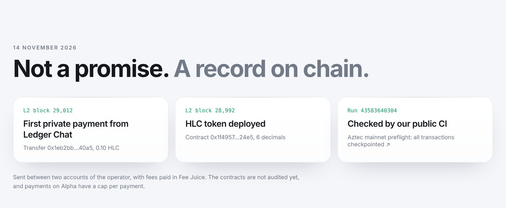
</p>

This file is an evaluation dossier. It is written so that an engineer can decide in about fifteen minutes whether the project deserves a deeper review. Every value below is copied from a file in this repository; [`docs/readme/FACTS.md`](docs/readme/FACTS.md) lists each one with its source file and line.

**Read this first.**

* No external audit has been done. On Aztec Alpha, payments from the app are capped per payment.
* Aztec Alpha carries real value and is, in Aztec's own words as recorded in [`deployments/aztec-mainnet.json`](deployments/aztec-mainnet.json), live but early, with critical bugs expected.
* Every private payment on Alpha recorded in this repository (four) went between two accounts of the operator. The operator states that a private transfer between two non-operator accounts succeeded. No hash was supplied, so R8 stays open.
* Ledger Chat pays no network fees for anyone: each account pays its own, with Fee Juice it bridges or that a contact pays through a fee link. `/api/aztec/sponsor` answers 410. The account that pays a fee, and its Fee Juice balance, are public; the sender, recipient and amount of a private transfer are not.
* The protocol fee exists in the escrow and stream source and is not deployed anywhere. Its treasury is the Aztec account `0x177395a38df8c95a572d3e7591240312b2fddbaf14d294d9e1443f3b0d55faed`, designated by the operator on 17 November 2026. It is not the 4-of-7 multisig of the launch conditions.
* The Ethereum portal and receiver addresses (added 17 November 2026) are written and tested in CI and **deployed nowhere**. The wallet says so and moves no money through them.
* Passkeys open the private wallet by unwrapping the same account root the Ethereum wallet signs. Whoever holds an enrolled passkey can spend, exactly like whoever holds the wallet.
* Community posts are not end-to-end encrypted. Our server can read them, and the app says so on the community screen.
* HLC is a test token with no monetary value, issued by the operator only to test private payments in the closed alpha. It is never sold or offered (decision PA-1). Real payments are planned in cUSDC, issued by human.tech, and stay off ([`lib/payments/assets.ts`](lib/payments/assets.ts)).
* Humanity Ledger is not affiliated with, endorsed by or audited by Aztec Labs, the Aztec Foundation or XMTP Labs.

---

## Contents

1. [Status](#1-status-as-of-17-november-2026)
2. [Architecture](#2-architecture)
3. [Private payments on Aztec Alpha](#3-private-payments-on-aztec-alpha)
4. [G7: binding a chat identity to an Aztec address](#4-g7-binding-a-chat-identity-to-an-aztec-address)
5. [Passkeys and the account model](#5-passkeys-and-the-account-model)
6. [Ethereum portal and receiver addresses](#6-ethereum-portal-and-receiver-addresses)
7. [Encrypted local storage](#7-encrypted-local-storage)
8. [aztec-nr contracts](#8-aztec-nr-contracts-aztec-600)
9. [Standalone Noir circuits](#9-standalone-noir-circuits-experimental)
10. [Cryptographic anchors](#10-cryptographic-anchors)
11. [What the tests prove, and what they do not](#11-what-the-tests-prove-and-what-they-do-not)
12. [Explicit non-claims](#12-explicit-non-claims)
13. [The product](#13-the-product)
14. [Reproduce](#14-reproduce)
15. [Open technical questions for Aztec Labs](#15-open-technical-questions-for-aztec-labs)
16. [Roadmap](#16-roadmap)
17. [Governance, security and licence](#17-governance-security-and-licence)

---

## 1. Status as of 17 November 2026

| Component | Network | State | Evidence |
|---|---|---|---|
| Direct messages | XMTP v3 | Real. MLS is provided by XMTP; we do not implement it | XMTP browser SDK 5.2.0, [`docs/STATUS.md`](docs/STATUS.md) |
| Private wallet: send, shield, unshield | Aztec Alpha and testnet | Real. Four private transfers on Alpha (blocks 29012, 29771, 29895, 29923) | [`deployments/aztec-mainnet.json`](deployments/aztec-mainnet.json), [section 3](#3-private-payments-on-aztec-alpha) |
| Gas estimation for transfers and account creation | Aztec Alpha | Real since 14 Nov 2026: limits from a simulation, so an account holds about 15 AZTEC instead of about 42 | [`lib/aztec/fee-juice.ts`](lib/aztec/fee-juice.ts) (`gasLimitsFromSimulation`, `budgetFeeFor`) |
| New user with no AZTEC | Aztec Alpha | Real once: a contact paid Fee Juice through a fee link, the account was created and sent its first payment | `newUserFlow` in [`deployments/aztec-mainnet.json`](deployments/aztec-mainnet.json) |
| HLC token | Aztec Alpha | Active since block 28992. An earlier HLC is retired | [`deployments/aztec-mainnet.json`](deployments/aztec-mainnet.json) |
| G7 peer binding | Client | Real in unit tests. Since 17 Nov 2026 the proof names the Aztec network (scheme v2), and on Alpha a proof without a network is refused. Not yet run between two different people (R8) | [`lib/aztec/peer-binding.ts`](lib/aztec/peer-binding.ts), `test/unit/aztec/peer-binding.test.ts`, `test/unit/aztec/peer-binding-network.test.ts` |
| Passkeys for the private wallet | Client and backup | Real in code and unit tests since 17 Nov 2026 (WebAuthn PRF). Not yet tested on a real device | [`lib/aztec/wallet/passkey.ts`](lib/aztec/wallet/passkey.ts), [`docs/ACCOUNT_MODEL.md`](docs/ACCOUNT_MODEL.md), `test/unit/aztec/passkey.test.ts` |
| Ethereum portal, receiver addresses, PortalToken | None | Written 17 Nov 2026. Hardhat suite and 11 TXE tests green in CI. Not deployed on any network, not audited | [`contracts/portal/`](contracts/portal/), [`contracts/aztec/portal_token/`](contracts/aztec/portal_token/), [`docs/PORTAL.md`](docs/PORTAL.md), [`docs/RECEIVER_ADDRESSES.md`](docs/RECEIVER_ADDRESSES.md) |
| Encrypted local message store | Client | Real since 13 Nov 2026. Since 17 Nov 2026 its key is kept on the device under a non-extractable browser key, so signing in takes one signature | [`lib/xmtp/device-key-vault.ts`](lib/xmtp/device-key-vault.ts), [`lib/xmtp/db-key.ts`](lib/xmtp/db-key.ts) |
| Escrow and payment streams (aztec-nr) | Testnet only | TXE tests in CI (section 8); end to end on testnet | [`docs/AZTEC_TESTNET_DEPLOYMENTS.md`](docs/AZTEC_TESTNET_DEPLOYMENTS.md) |
| Escrow and streams on Alpha | Off | Refused in the client and the scripts: no external audit (`audit: null`) | [`lib/protocol/agreement-gate.ts`](lib/protocol/agreement-gate.ts), [`docs/MAINNET_READINESS.md`](docs/MAINNET_READINESS.md) |
| Protocol fee (escrow and streams) | None | In the source, settlement only, to the designated treasury. CI compiled it with Aztec 6.0.0 and TXE passed (17 Nov 2026). Current classes: escrow `0x2ade61…9504c6`, streams `0x0251d1…c6777b`. Not deployed. Not on Alpha: no external audit | [`docs/protocol/FEE_CONTRACT_SPEC.md`](docs/protocol/FEE_CONTRACT_SPEC.md), [`deployments/aztec-testnet.json`](deployments/aztec-testnet.json) |
| Standalone Noir circuits | None | Tests only. Known soundness issues ZK-01 to ZK-07 | [section 9](#9-standalone-noir-circuits-experimental) |
| Calls (voice, video, screen) | WebRTC | Real. Since 17 Nov 2026 a call rings without its chat open and hangs up on both sides in every state. TURN relay keys set on 14 Nov 2026; a call across two different networks is not yet recorded (R3) | [`docs/CALLS.md`](docs/CALLS.md) |
| Community posts | Our server | Readable by our server, not end-to-end encrypted (`communityMls` is false), and the community screen says so | [`docs/communities/MLS_MIGRATION.md`](docs/communities/MLS_MIGRATION.md) |
| Community apps sandbox | Client | Real: sandboxed frame, no network | `test/eaf_isolation.adversarial.test.ts` |
| L1 contracts (Solidity) | None | Tests in CI only (Hardhat, including `HLPortal` and the receiver factory), not deployed | `npm run test:contracts` |
| External audit | — | None | `audit: null` in [`deployments/aztec-mainnet.json`](deployments/aztec-mainnet.json) |

---

## 2. Architecture

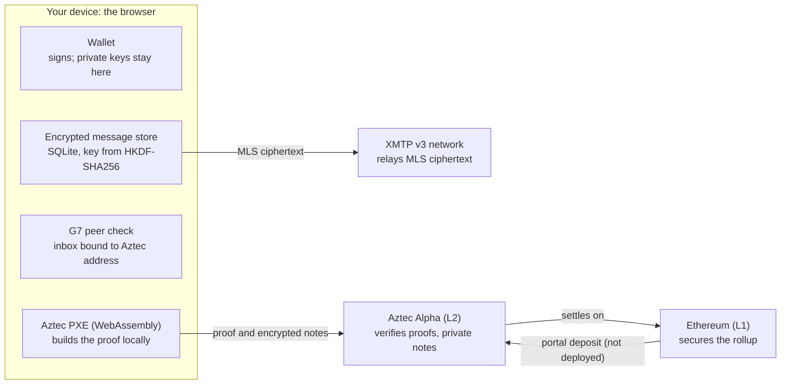

| Boundary | What crosses it | What never does |
|---|---|---|
| Device to XMTP | MLS ciphertext, inbox IDs, timing | Plaintext messages, the local database key |
| Device to Aztec Alpha | A zero-knowledge proof, note hashes, nullifiers, encrypted notes, the public fee payment | Private keys, amounts, recipients, private inputs |
| Device to Ledger Chat servers | Sign-in (SIWE), presence, encrypted offline messages, community posts | Message content of direct messages, wallet keys |
| Aztec to Ethereum | Rollup proofs and state roots | Anything about an individual private transfer |
| Ethereum to Aztec through the portal (not deployed) | A deposit's token, amount and secret hash; the receiver address it came through | The Aztec account that claims it |

1. **Messaging.** One-to-one messages travel over XMTP v3, which implements MLS (RFC 9420). Keys are updated as the conversation goes on (TreeKEM). XMTP protects content, not all metadata: the network sees that two inboxes exchange traffic.
2. **Payments.** The browser runs Aztec's Private Execution Environment (PXE) with a Schnorr account. Its keys are derived from a signature by the user's Ethereum wallet ([`lib/aztec/wallet/`](lib/aztec/wallet/)). The PXE builds an UltraHonk proof on the device and sends only the proof and encrypted outputs to the network.
3. **Fees.** On Alpha, an account pays its own fees in Fee Juice, which is AZTEC bridged one way from L1. Aztec runs no public Sponsored FPC on Alpha, so the account is the visible fee payer of each transaction: amounts and recipients stay private, but the account's transactions can be linked to each other ([`lib/aztec/fee-juice.ts`](lib/aztec/fee-juice.ts), lines 1 to 40). Ledger Chat sponsors no fee: a user with no Fee Juice bridges AZTEC, or a contact pays through a fee link.
4. **Binding chat and payments.** Before any private payment, G7 checks that the Aztec address belongs to the person at the other end of the XMTP conversation ([section 4](#4-g7-binding-a-chat-identity-to-an-aztec-address)).

### A payment, step by step

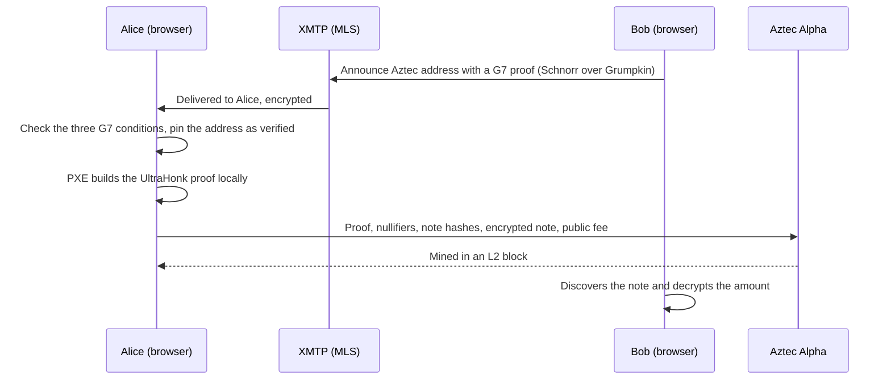

---

## 3. Private payments on Aztec Alpha

Aztec Alpha is Aztec's network with real value, settled on Ethereum mainnet (chain 1). Node and rollup are recorded in [`deployments/aztec-mainnet.json`](deployments/aztec-mainnet.json) (`network`: Aztec 6.0.0 Tierra, rollup version 2070860440).

| Step | Transaction | L2 block | Explorer |
|---|---|---|---|
| Deploy HLC | `0x1b1031703d15a1cd77507a241c8d3715fb6b80baf484fc9676ad968f3ae47d1c` | 28992 | [view](https://aztecscan.xyz/tx-effects/0x1b1031703d15a1cd77507a241c8d3715fb6b80baf484fc9676ad968f3ae47d1c) |
| Issue 1 HLC to the sender's private balance (`mint_to_private`) | `0x1d90c138f482e08f2fe4d5cc28e5131a4811ab561e17e6994eab50113fd68940` | 29001 | [view](https://aztecscan.xyz/tx-effects/0x1d90c138f482e08f2fe4d5cc28e5131a4811ab561e17e6994eab50113fd68940) |
| Private transfer of 0.10 HLC (R1, operator tool) | `0x1eb2bb76ae52d876e0ef8e107bf9de5b83ce9cb42850a1a1a938cae3c24040a5` | 29012 | [view](https://aztecscan.xyz/tx-effects/0x1eb2bb76ae52d876e0ef8e107bf9de5b83ce9cb42850a1a1a938cae3c24040a5) |
| Private transfer of 0.9 HLC (regular wallet screen) | `0x0a333fc0b698454e51f28d8ee18dcf3174a21605479a40a67568d4295c6fcc94` | 29771 | [view](https://aztecscan.xyz/tx-effects/0x0a333fc0b698454e51f28d8ee18dcf3174a21605479a40a67568d4295c6fcc94) |
| Issue 1 HLC | `0x2956a31a9e98199f5efe3c98419db639b61931348734bf4baa9f9d099a02d0f9` | 29893 | [view](https://aztecscan.xyz/tx-effects/0x2956a31a9e98199f5efe3c98419db639b61931348734bf4baa9f9d099a02d0f9) |
| Private transfer, first with estimated gas limits | `0x2ccd3893dd2fc7e548ef75f04fc6ecbd6870b9db0c06d49875e6b39144cda6db` | 29895 | [view](https://aztecscan.xyz/tx-effects/0x2ccd3893dd2fc7e548ef75f04fc6ecbd6870b9db0c06d49875e6b39144cda6db) |
| Private transfer of 0.01 HLC from an account created with a contact's deposit | `0x14a71087ff658c6d85d37e11a79b487f46aff73b0eea1b4252ece00ebf8bef49` | 29923 | [view](https://aztecscan.xyz/tx-effects/0x14a71087ff658c6d85d37e11a79b487f46aff73b0eea1b4252ece00ebf8bef49) |

* **Sender** `0x1cf28fb5c786f5d7587c3a97790cef3d5e4dc453d485efd0b463cb1a8e81fe42` (admin of HLC). **Recipient** `0x2ce757e8fc073f67b9e9307ed255fa37ac69b05f6712af31517d6c1e79abb11a`. Both are accounts of the operator.
* The first three transactions were proved in Chrome on Windows with MetaMask and confirmed by the read-only workflow "Aztec mainnet preflight", run 43583640304. The later ones are confirmed on Aztecscan (status mined, revert code 0) and not yet by a preflight run.
* **On chain**, a transfer shows note hashes, nullifiers and the public fee payment. It does not show the sender, the recipient or the amount.

<p align="center">
  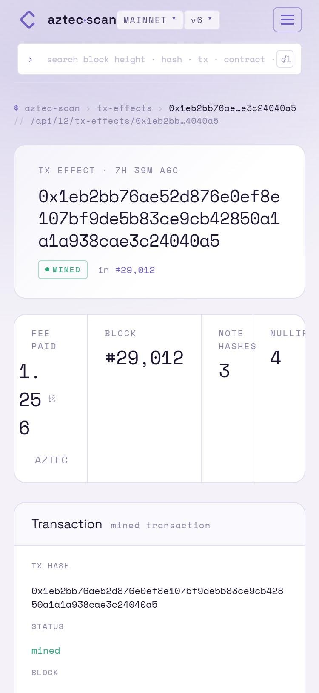
</p>

### Fees on Alpha

Fees charged, read from Aztecscan; L2 gas derived from the fee at the day's minimum fee per L2 gas ([`measuredFees`](deployments/aztec-mainnet.json)).

| Transaction | L2 block | Fee charged | About |
|---|---|---|---|
| Private transfer (operator tool) | 29012 | 1.256 AZTEC | 0.39M L2 gas |
| Private transfer that also claimed a 47 AZTEC deposit | 29771 | 2.858 AZTEC | 0.88M L2 gas |
| Issue HLC | 29893 | 1.657 AZTEC | 0.51M L2 gas |
| Private transfer with estimated gas limits | 29895 | 1.233 AZTEC | 0.38M L2 gas |
| Account creation, claiming a contact's deposit | 29921 | 1.7989 AZTEC | 0.56M L2 gas |
| Private transfer from that new account | 29923 | 1.307 AZTEC | 0.40M L2 gas |

**Why accounts used to need about 42 AZTEC.** The node accepts a transaction only if the fee payer can cover its *maximum* fee: gas limits times maximum fee per gas. The wallet sent every transaction with the protocol's gas limit (`MAX_PROCESSABLE_L2_GAS`), so a payer had to hold about 42 AZTEC for transfers charged 1.2 to 2.9.

**What the wallet does now** ([`lib/aztec/fee-juice.ts`](lib/aztec/fee-juice.ts), [`lib/aztec/wallet/client.ts`](lib/aztec/wallet/client.ts)):

1. Before sending a transfer or creating an account, it simulates the transaction (`simulate({ includeMetadata: true, skipFeeEnforcement: true })`, aztec.js 6.0.0) and sets the gas limits to the gas used, padded by 25% plus a fixed margin (`gasLimitsFromSimulation`).
2. It asks an account to hold `budgetFeeFor`: the maximum fee of a 3M L2 gas transaction at twice the node's minimum fees, about 15 to 19 AZTEC at the fees of 14 November. Every transaction measured above used under 0.9M.
3. If an estimate fails, the protocol defaults are used and the node asks for the full maximum, as before.

<p align="center">
  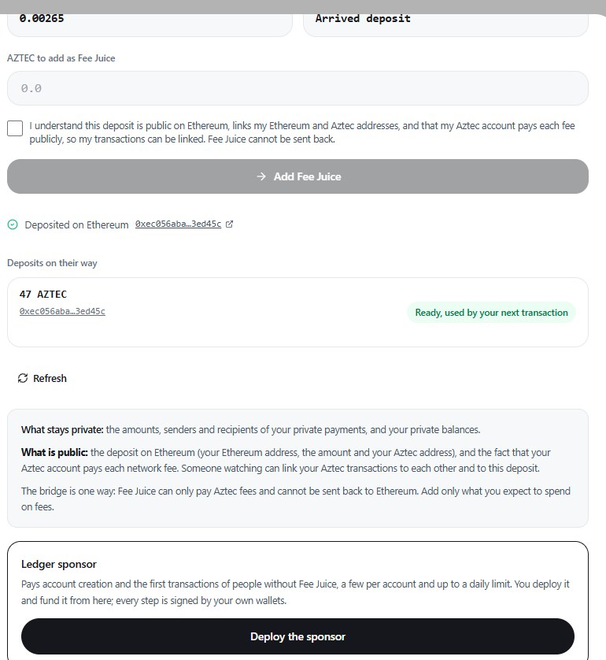
</p>

### A new user, end to end

The path a person with no AZTEC takes, run on 14 November 2026 between two accounts of the operator:

| Step | Evidence | Cost |
|---|---|---|
| A contact pays 20 AZTEC of Fee Juice through the account's fee link (`/fees`) | L1 `0x8bb89e6c377f28e055e5d7ff8f5809ddaa60585e63783ab416796d598d022cbd`, block 26415154, to the pinned FeeJuicePortal `0x534361be805CA30Bdb6404eC5E6cDAFFB3E9f3b3` | 108,854 L1 gas |
| "Check for fees" finds the deposit, searching the portal's logs in 9,000-block windows | Wallet screen | — |
| The account is created, claiming the deposit | L2 block 29921 | 1.7989 AZTEC |
| Its first private payment, 0.01 HLC | L2 block 29923 | 1.307 AZTEC |

Record: `newUserFlow` in [`deployments/aztec-mainnet.json`](deployments/aztec-mainnet.json) and [`docs/MAINNET_READINESS.md`](docs/MAINNET_READINESS.md). The same path between two different people is R8.

<p align="center">
  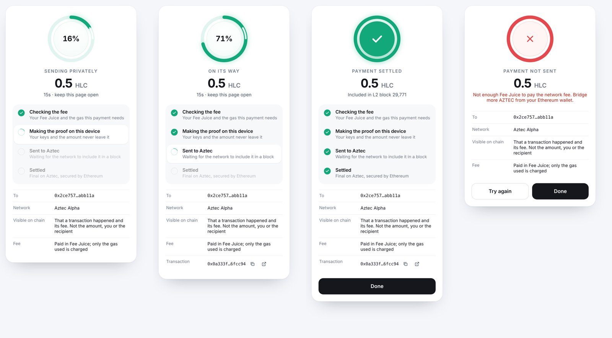
</p>

While a payment runs, the wallet shows one card with a green ring that fills through the payment's real stages, read from the wallet's own activity record: checking the fee, making the proof on this device, sent to Aztec, settled in block N. It shows what is visible on chain, the fee rule and the transaction hash with an explorer link ([`components/zk/PaymentProgress.tsx`](components/zk/PaymentProgress.tsx)).

### Network fees: no sponsorship

Ledger Chat sponsors no network fee (product decision, 15 November 2026). Every transaction on Alpha, including
the one that creates an account, is paid with the account's own Fee Juice: bridged by the user, or by a contact
through a fee link. No sponsor contract, route or client path remains in the code
(`test/unit/aztec/no-sponsorship.test.ts`).

### HLC, active and retired

| | Active HLC | Retired HLC (do not use) |
|---|---|---|
| Address | `0x1f49571a48699da4e70e1b7dbc5afcea5bb712f7b2cfaf432353e694851e24e5` | `0x2cd0f3775d129210ecf2165e338e1b6b708f2243ac1b30feb0ac49875366e55d` |
| Class ID (standard `Token`) | `0x067df4ddda0b0872ef604f47f3681d5e8c0de98280ac6b79963851c055ba91e0` | same class |
| Deploy transaction | `0x1b1031703d15a1cd77507a241c8d3715fb6b80baf484fc9676ad968f3ae47d1c` | `0x0dfc7146b9f807432d06bccf43d3cea88e849455f8f62372ea2b93d41be29136` |
| L2 block | 28992 | 24544 |
| Admin | `0x1cf28fb5c786f5d7587c3a97790cef3d5e4dc453d485efd0b463cb1a8e81fe42` | `0x01c7e18f1751ea94e3d63aad2d0b7221642ad299454f769103f0d32364ce549b` |
| Why | Deployed from the Ledger Chat private wallet, universal deployment | Nobody holds the key of its admin account, so it can never be issued |

Name "Humanity Ledger Corp.", symbol HLC, 6 decimals. That name suggests a company that does not exist, so a new instance named "HLC Test Token" is prepared ([`docs/alpha/HLC_REDEPLOY_RUNBOOK.md`](docs/alpha/HLC_REDEPLOY_RUNBOOK.md)). The wallet keeps HLC in an internal slot named `USDC`; that name is never shown to users and HLC has no relation to USDC.

---

## 4. G7: binding a chat identity to an Aztec address

**The problem.** XMTP authenticates the peer's inbox, which is bound to an Ethereum identity. It says nothing about Aztec. Without a binding, a relay or a third party could substitute its own Aztec address for the peer's, and a payment would go to the wrong person.

**The proof.** The peer announces its Aztec address in the same encrypted DM, with a Schnorr signature over Grumpkin made with the account's signing key:

```text
sha256ToField("hl/aztec-binding/v2 | <address> | <signerInboxId> | dm:<recipientInboxId> | net:aztec:<l1ChainId>:<rollupVersion>")
```

Since 17 November 2026 the wallet issues scheme v2, which names the Aztec network. A v2 proof made for another network is refused, and on Alpha (`requireNetwork`) a v1 proof without a network is refused too: a test-network announcement can never direct a payment of real value. On the test network, v1 proofs from older clients are still read.

**What the receiver checks**, in this order ([`lib/aztec/peer-binding.ts`](lib/aztec/peer-binding.ts)):

1. `signerInboxId` is the XMTP-authenticated sender of the message, and `recipientInboxId` is the receiver. A proof made for one person cannot be replayed to another.
2. The announced address is exactly the Schnorr account address computed from the signing public key, salt and public keys, as `AccountManager.create` does in aztec.js 6.0.0.
3. The signature verifies with that signing public key over the message above.
4. Scheme v2: the network in the statement is this wallet's network.

Only then is the address pinned as verified, keyed by the peer's inbox ID. A later, different address is reported as a conflict and never replaces the pinned one silently.

**What it does not prove.** A valid proof shows the sender holds the signing key that authorises transactions for that address. It does not show the sender holds that address's privacy keys, which are public data. A dishonest peer could announce an address built from someone else's public keys; funds sent there would be unusable by both. That harms only people who pay that peer, which a dishonest peer can do anyway. G7 closes the attack it is about: a third party substituting its own address.

**Status.** Unit tests in `test/unit/aztec/peer-binding.test.ts` and `test/unit/aztec/peer-binding-network.test.ts`. A run between two different people on Alpha is still open (R8).

---

## 5. Passkeys and the account model

The **account root** is the EIP-712 signature by the person's Ethereum wallet over the network's typed data ([`lib/aztec/wallet/keys.ts`](lib/aztec/wallet/keys.ts)). Every Aztec key is derived from it with HKDF-SHA256: the account secret, the salt, the Schnorr signing key, the store key and the Fee Juice claim secrets. Aztec Alpha and the test network sign different messages, so they are different accounts.

A **passkey** is a second way to obtain that root ([`lib/aztec/wallet/passkey.ts`](lib/aztec/wallet/passkey.ts), [`docs/ACCOUNT_MODEL.md`](docs/ACCOUNT_MODEL.md)):

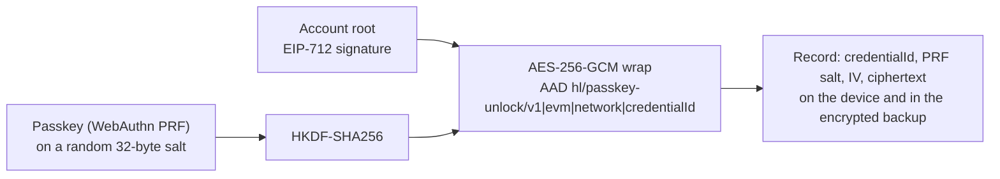

* The record holds no secret. The backup (`/api/aztec/passkeys`) accepts only the signed-in wallet's own records, at most 10 per account and network, and cannot open them.
* Unlocking asks for any enrolled passkey of the account. Before any key is derived, an ECDSA root must recover to the account's Ethereum address over this network's typed data, so a record can never open a different account. Records already on the device are never replaced by the backup.
* Passkeys are bound to `ledgerchat.org` on every subdomain; browsers refuse that relying party on any other site.
* **What a passkey can do.** Open the wallet and spend, like the Ethereum wallet. Removing one deletes its record; it does not rotate the account.
* **Recovery.** The Ethereum wallet always recovers the account. If it is lost, an enrolled passkey does. If both are lost, nobody can, Ledger Chat included.
* **Not done.** A passkey as the account's *signing* key, verified by the account contract (secp256r1 in Noir). It needs a new account contract, its audit and a migration; until then the Schnorr key is derived in the browser.
* **Not verified.** No real authenticator has been tested yet (iCloud Keychain, Google Password Manager, 1Password, Windows Hello, YubiKey).

In the wallet, **Security** lists these facts with their real state, next to what does not hold yet: the public fee payer and the missing external audit.

---

## 6. Ethereum portal and receiver addresses

A way in from any Ethereum wallet, and back out, written on 17 November 2026 and **deployed nowhere** ([`docs/PORTAL.md`](docs/PORTAL.md), [`docs/RECEIVER_ADDRESSES.md`](docs/RECEIVER_ADDRESSES.md)).

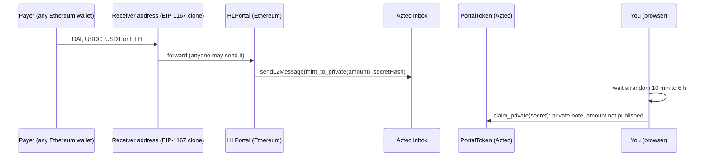

| Piece | What it does | Where |
|---|---|---|
| `HLPortal` | Deposits DAI, USDC, USDT and WETH (ETH is wrapped). Minimum, per-deposit, per-sender daily and global daily caps; fee-on-transfer tokens refused. Guardian or admin can pause and lower caps at once; anything that relaxes them waits 2 days in public. Withdrawals can be paused for at most 3 days, then not again for 4 | [`contracts/portal/HLPortal.sol`](contracts/portal/HLPortal.sol) |
| Receiver addresses | One Ethereum address per payer, an EIP-1167 clone at a CREATE2 address from `keccak256(abi.encode(secretHash, rescueSigner))`, derived from the account root. Anyone can forward its balance into the portal; only the account can rescue it (EIP-712) | [`contracts/portal/HLReceiver.sol`](contracts/portal/HLReceiver.sol), [`lib/portal/receivers.ts`](lib/portal/receivers.ts) |
| `PortalToken` | The Aztec side: `claim_private` consumes the L1 message into a private balance, `withdraw_private` burns and sends the L2 to L1 message. No public supply, no admin | [`contracts/aztec/portal_token/`](contracts/aztec/portal_token/) |

**What stays unlinkable.** Nothing on Ethereum names the Aztec account: a deposit carries only a secret hash, and a claim publishes no amount. **What does not.** The payer, the receiver address and the amount are public on Ethereum; payments to one receiver address are visibly grouped; the claim's fee payer is public until private fees exist; a withdrawal's recipient and amount are public by nature.

**Safeguards in the wallet** (17 November 2026):
* The portal turns on only when the build pairs Alpha with Ethereum (or the test network with Sepolia) and every Ethereum asset is its canonical token with its real decimals ([`lib/portal/config.ts`](lib/portal/config.ts)).
* Before proving, the wallet reads `portal_address()` from the PortalToken on the device and refuses one linked to any other L1 contract.
* Claims and withdrawals stay available in exits-only mode.
* The withdraw form stays off until the wallet also sends the final Ethereum step itself, so nothing is burned that only a script could finish.

**Tests.** `test/portal/HLPortal.test.ts` (Hardhat, 26 tests), the PortalToken TXE suite (11 tests) and `test/unit/portal/`, all in CI. Before any deployment: an external audit, a two-account run on Sepolia, and a multisig admin with a separate guardian ([`docs/PORTAL.md`](docs/PORTAL.md) section 7).

---

## 7. Encrypted local storage

The browser keeps the XMTP message history in a local SQLite database. Since 13 November 2026, nothing that can decrypt it is ever stored ([`lib/xmtp/db-key.ts`](lib/xmtp/db-key.ts), lines 1 to 26).

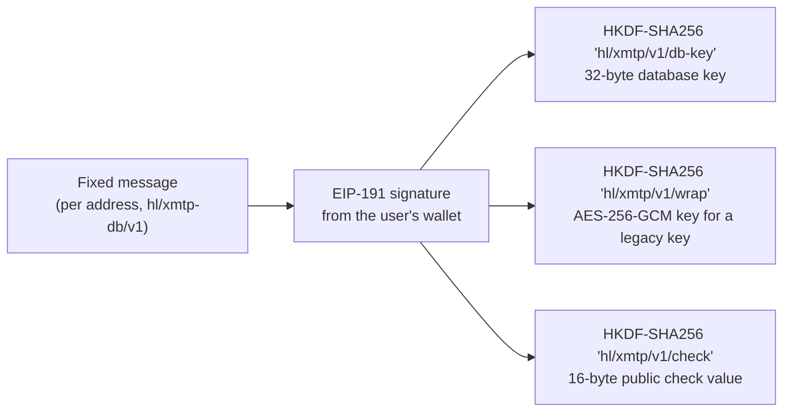

* **One signature since 17 November 2026.** The database key is now kept on the device, wrapped with AES-256-GCM by a non-extractable browser key in IndexedDB that no script can read or export ([`lib/xmtp/device-key-vault.ts`](lib/xmtp/device-key-vault.ts)). A new device gets a random key and asks for no signature; a database locked by the signature below is opened by it one last time and then re-wrapped. Where IndexedDB is unavailable, the signature path below is used as before. The trade-off is stated in the file: someone with this browser profile open can read the local copy, as in desktop messengers.
* The signature path: requested once per page load and kept in memory only. It is free and sends no transaction.
* The check value detects a different signature before the database is touched.
* Users from before 13 November keep their history: their old random key is encrypted with the wrap key and the plaintext copy is deleted. Until that date the key was stored in plaintext in `localStorage` (finding F-01).
* Fail closed: a refused signature, a signature that is not a 65-byte ECDSA signature, a different check value or a ciphertext that does not authenticate all stop the database from opening.

<p align="center">
  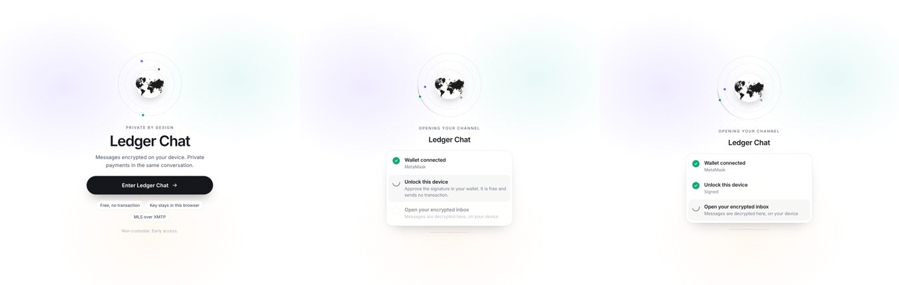
</p>

While the wallet asks for this signature, the entry screen names `ledgerchat.org` and tells the user never to sign the message on another site.

---

## 8. aztec-nr contracts (Aztec 6.0.0)

Three agreement contracts and the portal token, written against `aztec-nr` v6.0.0 in [`contracts/aztec/`](contracts/aztec/). They compile with Aztec 6.0.0 in CI (workflow "Aztec contracts") and pass their TXE tests there, using a test-only token. **None runs on Alpha.**

| Contract | What it does | TXE tests | Current class ID (testnet) |
|---|---|---|---|
| `PrivateEscrow` | A claim note for the recipient and a refund note for the sender emit the same settlement nullifier, so only one of claim and refund can land. Claim requires `anchor <= deadline`; refund requires `anchor > deadline`; a deposit cannot land after its own deadline. Protocol fee on claim only; a refund pays the full amount | 19 (16 Nov 2026) | `0x177021740d92d13f78e3f96a5bd3447eeb268cb6e9073e88832d14856b66e0ee` (not deployed) |
| `PaymentStream` | Accrual from the start time, capped at the total without overflow. Each state has an index and a state nullifier emitted by both withdraw and cancel; withdrawals hand the sender a copy of the next state. Protocol fee on each withdrawal, no minimum | 29 (16 Nov 2026) | `0x2c22f32674231c50fe77c970d5f604f9a5bd60f9dd800bd575c1f6f89eba1ae3` (not deployed) |
| `PortalToken` | The Aztec side of the Ethereum portal (section 6): claims an L1 deposit into a private balance with the depositor's secret, burns a private balance into an L2 to L1 withdrawal message. No public balance or supply, no admin | 11 (17 Nov 2026) | Not deployed |
| `IdentityCredential` | Depth-32 Poseidon2 membership, committed sanction lists, one `SingleUseClaim` per scope, issuer rotation in two steps | 20 (run 43646090307, 14 Nov 2026) | `0x1be813182640bfe08c2dea56bc3f96a7192b380a8dadc8210fc27ae0867e6c06` |

* **Protocol fee.** Spec sections 6 and 8 ([`docs/protocol/FEE_CONTRACT_SPEC.md`](docs/protocol/FEE_CONTRACT_SPEC.md)): 0.5%, escrow minimum 1,000 base units, at most 10% of the amount, a fee above 5 HLC refused, paid in the agreement's token to `TREASURY`. No owner, pause, oracle, buyback or daily cap. The two class IDs above were compiled with `TREASURY` as the zero placeholder. The source now names the designated treasury; until the "Aztec contracts" workflow recompiles it, TXE passes and the new class IDs are recorded, the app refuses to open an agreement with these classes. The earlier testnet instances are pre-fee classes and are kept as records only.

* **Keyed deployment.** Escrow and stream balances are token notes owned by the contract, so each agreement gets its own instance, deployed with public keys derived from a secret only its two parties hold ([`lib/aztec/keyed-deploy.ts`](lib/aztec/keyed-deploy.ts)).
* **End to end on testnet.** Keyed escrow (claim, and refund after the deadline) and stream (withdrawal bounded by accrual) ran in workflow "Aztec escrow e2e (testnet)", run 41881180186. The stored-terms views ran in run 42030688268. Every instance and transaction is in [`docs/AZTEC_TESTNET_DEPLOYMENTS.md`](docs/AZTEC_TESTNET_DEPLOYMENTS.md) and [`deployments/aztec-testnet.json`](deployments/aztec-testnet.json), checked daily against the node.
* **Do not use.** The first escrow and stream instances of 4 November were deployed without keys; tokens sent to them could never be spent.
* **Review.** Findings AZ-01 to AZ-23, fixes and open limits are in [`docs/zk/AZTEC_CONTRACTS_REVIEW.md`](docs/zk/AZTEC_CONTRACTS_REVIEW.md).

---

## 9. Standalone Noir circuits (experimental)

`circuits/escrow`, `circuits/identity` and `circuits/streams` compile with nargo 1.0.0 and prove with Barretenberg (@aztec/bb.js 5.3.0) in tests. **No page uses them.** The direction is the aztec-nr contracts of section 8.

| Circuit | Pinned VK SHA-256 ([`lib/zk/vk-pins.ts`](lib/zk/vk-pins.ts)) |
|---|---|
| `escrow` | `0x4e3cc4c8ce03607dcb2b98bd50c0d31084300634ee8f70f4674919682eb915c2` |
| `identity` | `0xcd02d2407de202d61e1a03c360633a9b0cdd8fe4b4d67b007cce108990632194` |
| `streams` | `0xa79000bf70441f02ce5ec092f15771e93dfc3d990977a33de9991795bc374346` |

| ID | Severity | Issue in v1 |
|---|---|---|
| ZK-01 | Critical | Streams: the same accrual can be claimed many times (reproduced in `test/circuits/streams_zk01_known_issue.test.ts`) |
| ZK-02 | Critical | Escrow and streams: proofs are not bound to the payout address, so they can be front-run |
| ZK-03 | High | Escrow: claiming requires the sender's secret; no refund path |
| ZK-04 | High | Identity: no domain separation between leaf and nullifier hashes |
| ZK-05 | High | Identity: depth-1 tree, an anonymity set of two |
| ZK-06 | Medium | Timestamps are chosen by the prover |
| ZK-07 | Medium | Verification did not pin the VK (fixed) |

**v2** (`circuits/*_v2`, shared `circuits/hl_lib`) fixes ZK-01 to ZK-05 with Poseidon2 and domain separators, a depth-32 tree and a committed sanction list. It compiles and passes 36 tests in CI; its VK hashes are pinned in `scripts/zk/v2-vks.mjs`. No deployed verifier stores its state ([`docs/zk/V2_CIRCUITS.md`](docs/zk/V2_CIRCUITS.md)).

---

## 10. Cryptographic anchors

Each value is copied from its source; [`docs/readme/FACTS.md`](docs/readme/FACTS.md) gives the line.

| Anchor | Value | Source |
|---|---|---|
| VK SHA-256, escrow | `0x4e3cc4c8ce03607dcb2b98bd50c0d31084300634ee8f70f4674919682eb915c2` | `lib/zk/vk-pins.ts` |
| VK SHA-256, identity | `0xcd02d2407de202d61e1a03c360633a9b0cdd8fe4b4d67b007cce108990632194` | `lib/zk/vk-pins.ts` |
| VK SHA-256, streams | `0xa79000bf70441f02ce5ec092f15771e93dfc3d990977a33de9991795bc374346` | `lib/zk/vk-pins.ts` |
| Class ID, `PrivateEscrow` (keyed, current) | `0x1fc9702de2946be7308126990f4cf3b8a3fbe9a4c53dc072d9ccb95bf9f04b5e` | `docs/AZTEC_TESTNET_DEPLOYMENTS.md` |
| Class ID, `PaymentStream` (keyed, current) | `0x1fd6afbe0bffe6a7cb675927dedc0aed886a46bf7c6d58edc32854af073701f2` | `docs/AZTEC_TESTNET_DEPLOYMENTS.md` |
| Class ID, `IdentityCredential` (current) | `0x1be813182640bfe08c2dea56bc3f96a7192b380a8dadc8210fc27ae0867e6c06` | `docs/AZTEC_TESTNET_DEPLOYMENTS.md` |
| Class ID, HLC (standard `Token`) | `0x067df4ddda0b0872ef604f47f3681d5e8c0de98280ac6b79963851c055ba91e0` | `deployments/aztec-mainnet.json` |
| HLC, active | `0x1f49571a48699da4e70e1b7dbc5afcea5bb712f7b2cfaf432353e694851e24e5`, block 28992 | `deployments/aztec-mainnet.json` |
| HLC, retired | `0x2cd0f3775d129210ecf2165e338e1b6b708f2243ac1b30feb0ac49875366e55d`, block 24544 | `deployments/aztec-mainnet.json` |
| Issue 1 HLC | `0x1d90c138f482e08f2fe4d5cc28e5131a4811ab561e17e6994eab50113fd68940`, block 29001 | `deployments/aztec-mainnet.json` |
| Private transfer 0.10 HLC | `0x1eb2bb76ae52d876e0ef8e107bf9de5b83ce9cb42850a1a1a938cae3c24040a5`, block 29012 | `deployments/aztec-mainnet.json` |
| Private transfer 0.9 HLC | `0x0a333fc0b698454e51f28d8ee18dcf3174a21605479a40a67568d4295c6fcc94`, block 29771 | `deployments/aztec-mainnet.json` |
| Mainnet preflight | run 43583640304 | `deployments/aztec-mainnet.json` |
| G7 binding scheme | `hl/aztec-binding/v2` (v1 read on the test network only) | `lib/aztec/peer-binding.ts` |
| G7 network tag | `aztec:<l1ChainId>:<rollupVersion>` | `lib/aztec/peer-binding.ts` |
| Passkey wrap scheme | `hl/passkey-unlock/v1` | `lib/aztec/wallet/passkey.ts` |
| Portal deposit content | `sha256ToField(mint_to_private(uint256))`, selector `0x8b3af5e8` | `lib/portal/receivers.ts`, `contracts/portal/AztecMessaging.sol` |
| Portal withdrawal content | `sha256ToField(withdraw(address,uint256,address))`, selector `0x69328dec` | `lib/portal/receivers.ts`, `contracts/portal/AztecMessaging.sol` |
| Receiver address salt | `keccak256(abi.encode(secretHash, rescueSigner))` | `contracts/portal/HLReceiver.sol` |
| Local store key version | `hl/xmtp-db/v1` | `lib/xmtp/db-key.ts` |

---

## 11. What the tests prove, and what they do not

| Suite | Count and date | What it shows | What it does not |
|---|---|---|---|
| Vitest unit and integration | 1,338 passing (CI, 4 Nov 2026) | Logic of the app, routes, key helpers, G7, the local store key | External services are mocked; not an end-to-end audit |
| aztec-nr TXE | Escrow 19 and streams 29 (fee baseline, 16 Nov 2026); identity 20 (run 43646090307, 14 Nov 2026) | Settle once, refund after the deadline, the fee on settlement, isolation between instances | Uses a test token; not run against Alpha; not yet run with the designated treasury |
| Testnet end to end | Runs 41881180186, 42030688268 | Keyed escrow and stream work on a live network | Test tokens only |
| Mainnet preflight | Run 43583640304 (weekly) | Our records on Alpha match the node | Read-only; sends nothing |
| Noir circuits v2 | 36 | v2 constraints | No verifier stores their state |
| L1 contract invariants (Hardhat) | 43 of 43 | Local invariants | Not deployed, not audited |
| Portal and receivers (Hardhat) | 26 (CI, 17 Nov 2026) | Caps, pause limits, timelocks, balance-delta deposits, Outbox consumption once, receiver prediction, forward and EIP-712 rescue | Mock Inbox and Outbox; not deployed, not audited |
| PortalToken TXE | 11 (CI, 17 Nov 2026) | A deposit is claimed once, only with its secret, amount and portal; a withdrawal burns and emits the exact content | Uses the TXE's message injection, not a real Inbox |
| Passkeys and G7 v2 (Vitest) | `test/unit/aztec/passkey.test.ts`, `peer-binding-network.test.ts` | Wrapping, binding to account and network, root ownership, local-first records, network-bound proofs | A simulated authenticator, not a real device |
| Property fuzzing | 60,000 iterations | Inputs to the tested functions | Not formal verification |

The TXE counts are read from the log of the "Aztec contracts" run named in the table; the other counts come from [`docs/ARCHITECTURE_AND_SECURITY_DOSSIER.md`](docs/ARCHITECTURE_AND_SECURITY_DOSSIER.md) and [`docs/AZTEC_FOUNDATION_DOSSIER.md`](docs/AZTEC_FOUNDATION_DOSSIER.md). All are as of the dates given. Run the commands in [section 14](#14-reproduce) for current numbers.

---

## 12. Explicit non-claims

1. **No external audit.** Payments on Alpha are capped. No claim of audited security is made. The protocol fee contracts are not deployed, and are refused on Alpha until an audit exists.
2. **Not adoption.** All four private payments on Alpha went between two accounts of the operator.
3. **HLC is not money.** It is issued by the operator, uncapped and unbacked.
4. **No quantum resistance.** BN254, secp256k1 and Curve25519 are classical.
5. **No traffic-analysis protection.** MLS protects content, not IP addresses, sizes or timing; on Alpha the fee payer of each transaction is public.
6. **No formal verification.** Tests and fuzzing are not machine-checked proofs.
7. **Community posts are readable by our server** and are not end-to-end encrypted, until they move to XMTP MLS groups.
8. **The fee is not private.** On Alpha the account that pays a network fee, and its Fee Juice balance, are public.
9. **The portal is not live.** `HLPortal`, the receiver addresses and `PortalToken` are deployed on no network and hold nothing.
10. **A passkey is not the signing key.** It unwraps the account root; the Schnorr signing key is still derived in the browser.
11. **No affiliation.** Aztec Labs, the Aztec Foundation and XMTP Labs have not reviewed, endorsed or audited this project.

---

## 13. The product

<p align="center">
  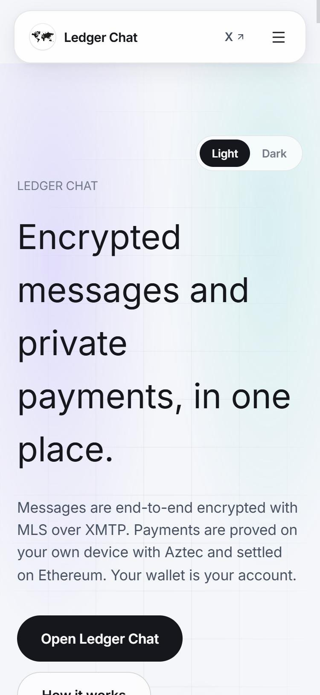
  &nbsp;
  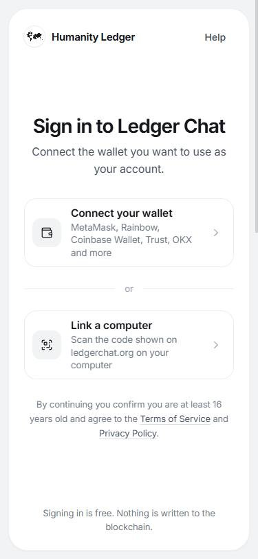
  &nbsp;
  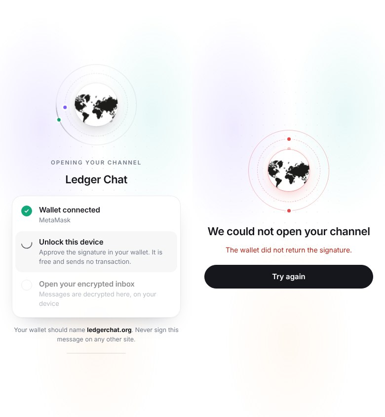
</p>

<p align="center">
  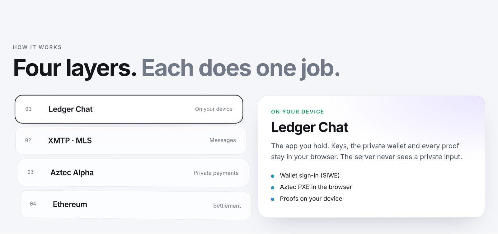
</p>

<p align="center">
  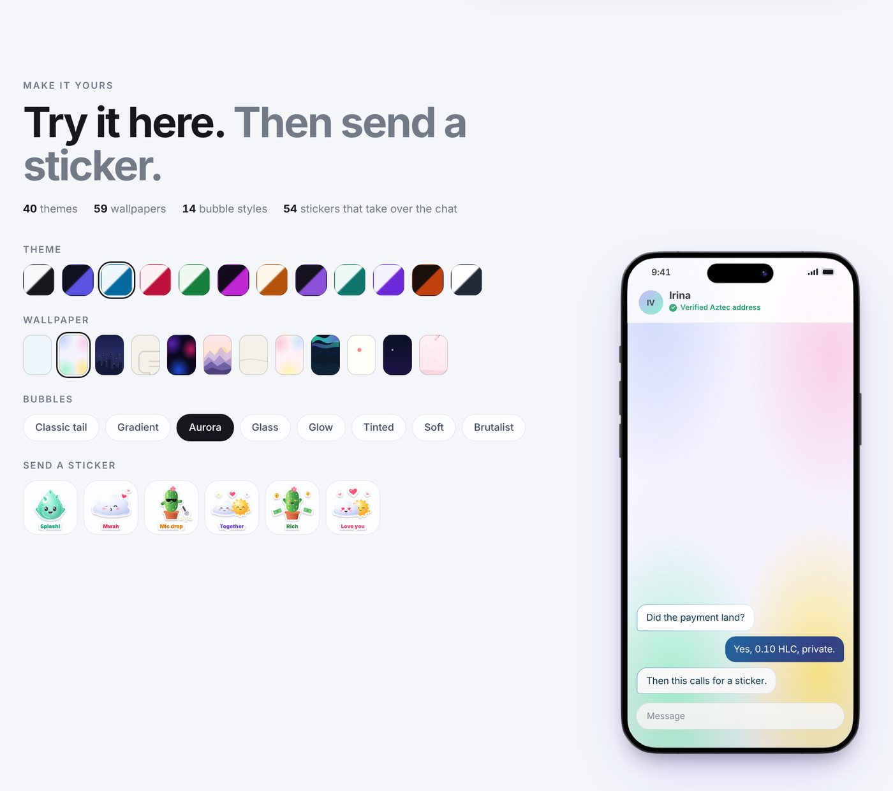
</p>

* **Sign in** with a browser wallet or WalletConnect (SIWE with a sealed single-use nonce), with one signature: the message database key is kept on the device (section 7). No phone number, email or password. On phones over WalletConnect, every signature waits for the relay to acknowledge the request and is opened from a tap, so iPhone and Android Chrome reach the wallet with the request in place ([`lib/auth/wc-sign-request.ts`](lib/auth/wc-sign-request.ts)).
* **Messages**: sent, delivered (double grey tick) and read (double green tick, if both have read receipts on). Long words wrap inside the bubble; below 1024 px the chat list and the open chat show one at a time; on iPhone the page does not zoom when typing.
* **Photos** are re-encoded in the browser before sending (JPEG, up to 2048 px, at most 700 KB), which also removes their metadata, including GPS position ([`lib/chat/compress-image.ts`](lib/chat/compress-image.ts)). Other files up to 20 MB need file storage (Cloudflare R2) to be configured.
* **Calls**: one-to-one voice and video over WebRTC with our own signalling server ([`docs/CALLS.md`](docs/CALLS.md)). A call rings wherever you are in the app, without its chat open, and answering opens the caller's chat. Hanging up or declining closes both sides in every state, including while connecting. Incoming, outgoing and voice screens are a card on a computer and full screen on a phone, with a single tap to answer. Screen sharing is offered only where the browser can capture.
* **Expressions**: emoji, stickers and GIFs in one panel, switched by tab or by swiping with a finger or a trackpad without the browser going back.
* **Voice messages** play on Safari: when the audio element cannot, the app decodes them with Web Audio, and otherwise says so and offers the file.
* **Clear chat** empties a conversation on this device, and the chat list respects it.
* **Communities**: start one with a name and a choice of private or public, and it opens. Open one to read its posts and write in one field; Send is the only action. **Manage** is a list of rows: pinned posts, members, invite, the admin settings, apps, analytics, governance, leave, and delete for the owner. A post is pinned only when someone chooses Pin. Posts are readable by our server, and the screen says so. Community apps run in a sandboxed frame with no network access.
* **Private wallet**: Overview (balances, send, receive, shield, Ethereum), Activity, **Security** (keys, ways to open, address checks, whether new payments are allowed, the public fee payer, the audit status, passkeys) and Protocol.
* **Appearance**: 40 themes, 59 wallpapers, 14 bubble styles and original sticker packs drawn for Ledger Chat.

Screenshots: `ledgerchat.org` on 14 November 2026 (phone), and components rendered from this repository. Images that still need a live session are listed in [`docs/readme/IMAGES_TODO.md`](docs/readme/IMAGES_TODO.md).

---

## 14. Reproduce

Requires Node 22.22.2 or later; nargo 1.0.0 for the circuits; the Aztec 6.0.0 toolchain for the aztec-nr contracts.

```bash
git clone https://github.com/humanityledger/Humanity-Ledger.git
cd Humanity-Ledger
npm ci

# Unit and integration tests
npm run test:run

# Claims and security patterns (run on every change)
npm run check:copy
npm run check:patterns

# aztec-nr contracts: compile and TXE tests (Aztec 6.0.0 toolchain)
(cd contracts/aztec/test_token && aztec compile)
for c in escrow identity streams portal_token; do (cd contracts/aztec/$c && aztec compile && aztec test); done

# Standalone circuits, artifacts and VK pins
for c in escrow identity streams; do (cd circuits/$c && nargo check && nargo test); done
node scripts/zk/check-artifacts.mjs
npx vitest run test/unit/aztec/circuit-proving.test.ts test/zk/ test/circuits/

# L1 contracts, including HLPortal and the receiver factory
npm run test:contracts

# Aztec testnet end to end (needs testnet configuration, see docs/AZTEC_E2E.md)
npm run test:aztec:e2e
```

The read-only Alpha checks run in GitHub Actions: "Aztec mainnet preflight" (`.github/workflows/aztec-mainnet-preflight.yml`) and "Aztec testnet deployments" (`.github/workflows/aztec-deployments.yml`). Neither sends a transaction.

---

## 15. Open technical questions for Aztec Labs

Each question names the code it concerns and what we do today. We ask only what the code leaves us genuinely unsure about.

| # | Context | Question | Code | What we do today |
|---|---|---|---|---|
| 1 | Claim and refund notes emit one settlement nullifier; claim needs `anchor <= deadline`, refund `anchor > deadline` | Is a shared settlement nullifier with these timestamp checks an idiomatic way to express "claim before the deadline, refund after it"? | `contracts/aztec/escrow/src/` | As described, 13 TXE tests and testnet runs |
| 2 | Each agreement is its own instance, deployed with public keys from a secret the two parties share | Is a keyed deployment with a shared secret the pattern you recommend for a contract that holds a private balance? | `lib/aztec/keyed-deploy.ts` | One instance per agreement, verified by recomputing address and class |
| 3 | Our contracts call the token through a raw `transfer_in_private` selector to avoid a token crate | Is depending on the standard Token interface preferred, and how do you avoid a duplicated `aztec` crate when doing so? | `contracts/aztec/escrow/src/`, `contracts/aztec/streams/src/` | Raw selector |
| 4 | Stream cancel shares a per-state nullifier with withdraw; withdrawals give the sender a copy of the next state | Is that the pattern you would use, or a delayed public mutable for the cancellation time? | `contracts/aztec/streams/src/` | Shared state nullifier, 22 TXE tests |
| 5 | A cancel measures accrual at its anchor block, chosen by the sender's PXE | Is there a better way to bound a time-dependent value in a private function than expiring the cancel 600 s after its anchor? | `contracts/aztec/streams/src/` | 600 s expiry |
| 6 | The node requires the fee payer's balance to cover the maximum fee. Since 14 Nov the wallet sets gas limits from a simulation padded by 25% (section 3) | Is padding `gasUsed` from `simulate({ includeMetadata: true })` the approach you recommend, and what padding is safe for private functions and teardown? | `lib/aztec/fee-juice.ts` (`gasLimitsFromSimulation`) | 25% plus a fixed margin; ×2 for sponsored transactions; defaults if the estimate fails |
| 7 | Alpha has no Sponsored FPC; paying with one's own Fee Juice makes the account the public fee payer | What is the recommended path to pay fees privately on Alpha today (a private FPC), and is there a reference implementation for apps? | `lib/aztec/fee-juice.ts` | Own Fee Juice, disclosed to the user before bridging. Ledger Chat sponsors no fee |
| 8 | A new account needs Fee Juice before its first transaction (about 15 AZTEC asked, 1.8 charged on 14 Nov); a contact can pay it through a fee link | How do you expect consumer apps to onboard users with no AZTEC: a sponsor contract per app, or something at the protocol level? | `docs/MAINNET_READINESS.md` (R4), `app/fees/page.tsx` | The user bridges AZTEC from L1, or a contact pays through a fee link. Ledger Chat sponsors no fee |
| 9 | G7 proves control of the signing key, not of the address's privacy keys | Is there a supported way to prove control of an address's privacy keys (or to derive the address so that it implies it) without revealing them? | `lib/aztec/peer-binding.ts` | Signing key proof; limit documented |
| 10 | A recipient may open the wallet long after a payment | Is note discovery for a recipient who was offline guaranteed without extra tagging by the sender in 6.0.0, and for how long? | `lib/aztec/wallet/client.ts` | Rely on the PXE's note discovery |

Questions 1 to 5 also appear in [`docs/AZTEC_FOUNDATION_DOSSIER.md`](docs/AZTEC_FOUNDATION_DOSSIER.md), section 5.

---

## 16. Roadmap

In order, from [`docs/MAINNET_READINESS.md`](docs/MAINNET_READINESS.md):

| # | Item |
|---|---|
| R1 | First real run on Alpha: **done**, 14 November 2026. Since then: payments from the regular wallet screen and the first new-user run (section 3) |
| R2 | Public and legal texts that match production: **open**, needs counsel |
| R3 | TURN relay for calls across networks: keys set in Railway on 14 November; **a call between two different networks still to be confirmed** |
| R4 | Onboarding for accounts with no Fee Juice: **done without sponsorship**. Gas estimation lowered the Fee Juice an account must hold from about 42 to about 15 AZTEC; a contact can pay it through a fee link (run once, section 3). Ledger Chat sponsors no fee, by product decision (15 Nov 2026) |
| R5 | A dollar-denominated token: **open**, after R4 and R7 |
| R6 | Escrow and streams on Alpha: **closed alpha, wave 1, decided 18 Nov 2026** (`docs/alpha/OPERATOR_DECISIONS.md`): at most 20 testers, HLC only, no protocol fee, at most 100 HLC per agreement, unaudited by written decision (OD-10). Classes recompiled in CI. Not deployed: the invitation gate, monitoring and a testnet rehearsal come first, and Stefan signs each deployment |
| R7 | External audit: **open** |
| R8 | G7 and a payment between two different people: **open**. The full path has run between two accounts of the operator |
| M3 | Private fee payment, so a claim or a withdrawal no longer names the account as fee payer: **waiting on Aztec** (Q8). Only through an FPC operated by Aztec or the community, never one of ours, which would make us a custodian (`docs/AZTEC_DECISIONS.md`). Ledger Chat still sponsors no fee |
| M2 | Ethereum portal and receiver addresses: **written and tested, not deployed**. Before deployment: R7, a two-account run on Sepolia, a multisig admin, and the wallet's own L1 payout step |
| R9 | Direct database URL for migrations: the pre-deploy settles migrations that cannot run on `0_init` (#99); `DATABASE_URL_UNPOOLED` must point at Postgres, not PgBouncer: **to be confirmed in the deploy log** |

NLnet: proposal `2027-01-04e` (€40,000) was submitted on 14 November 2026 and is under review; nothing has been awarded ([`docs/NLNET_DRAFT.md`](docs/NLNET_DRAFT.md)).

---

## 17. Governance, security and licence

* **Security policy:** [`SECURITY.md`](SECURITY.md). **Vulnerability disclosure:** [`docs/BUG_BOUNTY.md`](docs/BUG_BOUNTY.md).
* **Contributing:** [`CONTRIBUTING.md`](CONTRIBUTING.md).
* **Licence:** free and open source, `MIT OR Apache-2.0` at your option ([`LICENSE`](LICENSE), [`LICENSE-MIT`](LICENSE-MIT), [`LICENSE-APACHE`](LICENSE-APACHE)). It covers the whole repository: application code, aztec-nr contracts, Noir circuits, Solidity contracts, scripts, tests, deployment records and documentation. Contributions are accepted under the same terms (inbound = outbound, Apache-2.0 section 5).
* **Names, logos and third-party material:** the licence does not cover the names Humanity Ledger and Ledger Chat or their logos; forks are welcome under another name. Dependencies keep their own licences, and the logos of other projects in `public/` belong to their owners ([`NOTICE`](NOTICE)).
* **Contact:** Stefan Antonio Cirisanu, `humanityledger@icloud.com`.
