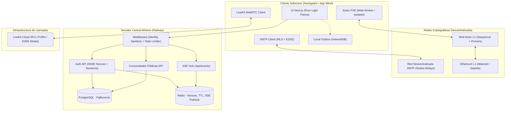

# Arquitectura Global de Humanity Ledger

> **Versión:** 2.0 (Post-Auditoría de Seguridad y Remediación Completa)
> **Fecha:** Octubre 2026

---

## 1. Diagrama de Arquitectura del Sistema

---

## 2. Separación de Responsabilidades y Límites de Confianza

| Dominio | Tecnología | Almacenamiento de Datos | Privacidad / Garantía |
| :--- | :--- | :--- | :--- |
| **Identidad** | SIWE (EIP-4361) + Sesión HttpOnly `hl_session` | Redis (Nonces de 10 min) + DB | Identidad autenticada estrictamente en backend |
| **Mensajería 1:1 y Grupos Privados** | XMTP v3 (MLS) | Dispositivo del usuario (IndexedDB) | Cero texto en servidores de Humanity Ledger |
| **Comunidades Públicas** | API Next.js + PostgreSQL | PostgreSQL (`CommunityPost`) | Contenido público, sanitizado con DOMPurify |
| **Pagos Privados** | Aztec L2 (UltraHonk / Noir) | Notas privadas en PXE del cliente | Balances y transferencias privadas; en DB solo `txHash` |
| **Llamadas y Audio** | LiveKit SFU + E2EE Media | Ninguno (solo tráfico de relay) | Sin grabación; tokens JWT efímeros de 10 min |
| **Eventos en Tiempo Real** | Server-Sent Events (SSE) + Redis | Redis PubSub (efímero) | Sin polling; conexión única multiplexada por usuario |

---

## 3. Principio de Cero Simulaciones
Todas las funciones del sistema están conectadas a oráculos reales (CoinGecko para precios con caché en Redis), redes de prueba reales (Aztec Testnet Sandbox), y SDKs oficiales validados en CI.
