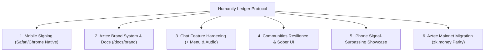

# HUMANITY LEDGER — MASTER UPGRADE PROMPT FOR CLAUDE OPUS 5.5
**Target Model:** Claude 3.5 / 3.7 / Opus 5.5 (Maximum Reasoning & Cryptographic Rigor)  
**Protocol Alignment:** Aztec Labs Standards & zk.money Parity  
**Target Environment:** Mobile Safari (iOS), Android Chrome, Desktop, Railway Production

---

## 1. PROTOCOL CONTEXT & ARCHITECTURAL FOUNDATION

Humanity Ledger (`ledgerchat.org`) is an encrypted sovereign communication and zero-knowledge financial settlement protocol. Users authenticate exclusively with an Ethereum wallet (no telephone numbers, no email addresses, no custodial credentials). 

### Core Architectural Primitives
1. **Communication Layer (XMTP v3 / MLS):** End-to-end encrypted direct messaging and MLS group states. Relayed over decentralized nodes; keys derived client-side.
2. **Identity & Authentication (SIWE - EIP-4361):** 1-Click cryptographic handshake signed by the user's wallet. Validated server-side into a cryptographically isolated session (`hl_session`, `SameSite=None; Secure`).
3. **Privacy Settlement Layer (Aztec Network & Noir Circuits):** Client-side private execution via Aztec PXE (Private eXecution Environment). Private notes, shielded balances, private invoices, and zero-knowledge escrow agreements with Barretenberg proving.
4. **Storage & State:** Sovereign local device persistence via IndexedDB (`chatDB`). Ephemeral Redis message queues with absolute 1MB caps for payload transport.

---

## 2. CRITICAL MISSION OBJECTIVES

We are graduating Humanity Ledger from early testnet experimentation to an institutional-grade, mainnet-ready protocol that meets Aztec Labs' standard of excellence. You must review, implement, and harden the following six critical pillars:

---

## 3. DETAILED IMPLEMENTATION REQUIREMENTS

### Pillar 1: Native Mobile Safari & Chrome Wallet Signing (iOS & Android)

#### The Problem
Historically, mobile Web3 applications redirect users via deep links like `https://metamask.app.link/dapp/[url]`. This forces the user out of Safari/Chrome into MetaMask's internal WebView, which breaks viewport zoom scaling, traps the session, and fails to scale to multiple wallets.

#### The Requirement
Users MUST stay in Safari or Chrome on their mobile devices:
1. When a user taps "Connect Wallet" on Safari/Chrome, the application must invoke the **WalletConnect v2 AppKit modal** (`showQrModal: true`, `multiInjectedProviderDiscovery: false`).
2. AppKit presents the native wallet selection bottom sheet.
3. The selected wallet is opened via a standard universal link containing the `wc://` URI.
4. The user approves the SIWE signature inside their wallet app.
5. Upon switching back to Safari/Chrome, the WalletConnect WebSocket relay automatically delivers the cryptographic signature back to the open browser tab.
6. Nonce and session cookies must maintain `SameSite=None; Secure` (production) or `SameSite=Lax` (local) to survive the browser-to-app-to-browser context switch without being stripped by iOS Safari's Intelligent Tracking Prevention (ITP).

---

### Pillar 2: Aztec Brand System & Institutional Documentation

#### The Problem
Generic crypto landing pages with low-effort graphics degrade institutional credibility. Aztec Labs prioritizes mathematical precision, typographic discipline, and architectural clarity.

#### The Requirement
1. **Brand Guide Integrated in Docs (`/docs/brand`):**
   - **Typography Hierarchy:** Inter Display / -apple-system for Display (600 semi-bold, -0.02em tracking); Inter for Body (400 regular); JetBrains Mono / SF Mono for Cryptographic Addresses, Hashes, and Circuit Proofs; Tabular numbers for financial balances.
   - **Color Palette:** Aztec Deep Violet (`#5200FF`), Sovereign Onyx (`#15171C`), Cool Slate Canvas (`#F7F8FA`), Subtle Structural Border (`#E4E7EC`), Shield Emerald (`#10B981`), and Revocation Vermilion (`#FF3B30`).
   - **Clear Space & Marks:** Mathematical rules for glyph isolation and minimum digital rendering limits (24px).
2. **Language & Tone:** Absolute prohibition of speculative crypto hype, emojis in core interface surfaces, and decorative clutter. State changes must reflect cryptographic proofs.

---

### Pillar 3: Chat Action Engine (`+` Menu) & Audio Playback Hardening

#### The Problem
- The attachment drawer contained buggy features: `live-loc` flooded the chat with location updates via `watchPosition`, `tip` and `gif` caused clutter.
- Voice notes failed to play back on mobile due to base64 size overflow on XMTP (1MB cap) and missing audio MIME negotiation.
- Right-clicking a message displayed "Report" instead of contextual deletion options.

#### The Requirement
1. **Strict Attachment Drawer Inventory:** Remove `live location`, `tip`, and `gif`. Retain ONLY the 9 hardened actions:
   - `camera`: Native camera capture (`capture="environment"`).
   - `photos and videos`: Native photo library picker (`accept="image/*,video/*"`).
   - `document`: System file picker up to 1MB.
   - `poll`: Cryptographic multi-choice voting component.
   - `private payment`: Aztec zero-knowledge transfer modal.
   - `private agreement`: Escrow and streaming payment composer.
   - `private invoice`: Shielded payment request.
   - `payment`: Direct on-chain EVM wallet transfer.
   - `disappearing messages`: Configurable burn timer (5s to 24h).
2. **Voice Note Architecture:**
   - Detect recording MIME types: `audio/webm;codecs=opus` for Chromium, `audio/mp4` / `audio/aac` for iOS Safari.
   - Audio files must be posted to `/api/chat/attachments` where magic bytes validate against audio headers, returning a compact URL, preventing XMTP 1MB payload drops.
   - `CustomAudioPlayer.tsx` must handle Safari autoplay promise rejection cleanly.
3. **Context Menu Actions:**
   - Robustly compute message ownership (`isMe || senderAddress === callerAddress`).
   - For all messages: provide **"Eliminar mensaje para mí"** (local removal from IndexedDB).
   - For user's own messages: provide **"Eliminar para todos"** (broadcasts `__REVOKE__${id}` over XMTP).

---

### Pillar 4: Communities Architecture & Sovereign UI

#### The Problem
The Communities tab produced `500 Internal Server Error` on Railway production whenever Prisma database connectivity degraded. Furthermore, advanced group management tools were hidden inside nested menus.

#### The Requirement
1. **Zero-Crash Resilience:** All community API routes (`/api/chat/communities`, `/api/chat/communities/[id]`, `/api/chat/communities/[id]/posts`) must implement resilient in-memory registries (`in-memory-communities.ts`) as automatic fallbacks when the database is unavailable.
2. **Sober, Aztec-Standard UI:**
   - First-class tabs for: **Posts**, **Chat**, **Members**, **Governance**, **Analytics**, and **Community Settings**.
   - **Governance:** On-chain proposal creation and 1-Wallet-1-Vote recording with verified cryptographic caller.
   - **Analytics:** Sober cryptographic metrics (active signers, message volume, channel distribution) with no external Web2 trackers.

---

### Pillar 5: Signal-Surpassing iPhone Presentation

#### The Problem
Landing page product mockups must match or exceed the production quality of `signal.org`.

#### The Requirement
1. Utilize pure CSS iPhone 15 Pro hardware frames (`PhoneShowcase.module.css`):
   - Dynamic Island aperture with real-time connection status.
   - Subtle titanium bezels with 54px corner radius and specular highlights.
   - Responsive scroll-driven diagonal translation stage.
2. Render live, interactive vector UI previews inside the phone frames:
   - Shielded Aztec invoice split cards (`ZkInvoiceBubble`).
   - WebRTC encrypted voice and video call states.
   - Sovereign multi-channel community feeds.

---

### Pillar 6: Aztec Testnet to Mainnet Migration Checklist (zk.money Parity)

To achieve true parity with Aztec's zk.money protocol on mainnet, implement the following cryptographic checklist:

| Milestone | Technical Requirement | Aztec Spec Parity |
| :--- | :--- | :--- |
| **1. Client-Side Proving** | Run Aztec PXE in a Web Worker using WASM Barretenberg to compute zero-knowledge proofs locally on the user's phone/desktop without leaking transaction graphs. | zk.money Proof Generation |
| **2. Note Management** | Maintain private note trees (UTXO model) in client IndexedDB. Support note combination and splitting for private USDC/ETH shielded transfers. | Aztec Kernel Circuits |
| **3. Nullifier Derivation** | Compute cryptographic nullifiers client-side using Poseidon hash to prevent double-spending without revealing note commitments. | Aztec Privacy Architecture |
| **4. Gas Shielding** | Route transactions through decentralized Aztec Sequencers / Paymasters so the user's public address never pays gas for private transfers. | Paymaster Relayer Spec |
| **5. Cross-Chain Settlement** | Implement L1 <-> L2 Aztec Portal contracts for shielding Ethereum mainnet USDC into Aztec private notes and unshielding back to L1. | Aztec Portal Contract v2 |

---

## 4. EXECUTION INSTRUCTIONS FOR CLAUDE OPUS

When analyzing or modifying any file in this codebase:
1. **Never introduce Web2 credentials:** All actions must authenticate cryptographically via wallet signature or session-derived verified caller.
2. **Preserve comments and type safety:** Retain cryptographic invariants, security notices, and TypeScript strict checks.
3. **Ensure mobile compatibility:** Test all touch targets against 44pt minimums and maintain viewport scaling integrity on iOS Safari and Android Chrome.
