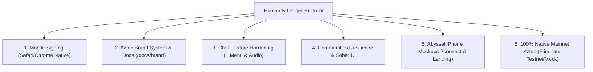
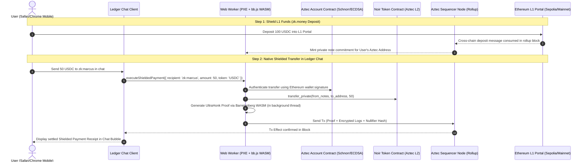

# HUMANITY LEDGER — MASTER UPGRADE PROMPT FOR CLAUDE OPUS 5.5
**Target Model:** Claude 3.5 Sonnet / Claude 3.7 Sonnet / Claude Opus 5.5 (Maximum Reasoning & Cryptographic Rigor)  
**Protocol Alignment:** Aztec Labs Standards & True zk.money Parity  
**Target Environment:** Mobile Safari (iOS), Android Chrome, Desktop, Railway Production  
**Repository:** `https://github.com/humanityledger/Humanity-Ledger` (main branch)

---

## 1. PROTOCOL STATUS & HONEST CODE AUDIT

Before writing code or architecting changes, you must understand the exact current state of Humanity Ledger (`ledgerchat.org`). We have completed an exhaustive audit of the codebase:

### Current Reality: What is Live vs What is Simulated
1. **Authentication & Identity (REAL):** 
   - SIWE (EIP-4361) 1-Click login signed by the user's Ethereum wallet.
   - Server verification in `/api/siwe/verify` issues `hl_session` with `SameSite=None; Secure` so mobile Safari keeps the session when returning from MetaMask/Rainbow/Trust.
2. **Messaging Layer (REAL):**
   - XMTP direct messaging with local IndexedDB (`chatDB`) storage on the user's device.
   - End-to-end encrypted packet relays with zero server message custody.
3. **Communities Engine (HYBRID RESILIENT):**
   - Dual-mode architecture: PostgreSQL via Prisma for persistent server storage, backed by `in-memory-communities.ts` as an automatic fallback when Railway DB connections experience latency, preventing `500 Internal Server Error`.
   - Top-level workspace navigation now directly surfaces: *Posts*, *Chat & Channels*, *View Members*, *Search Messages*, *Pinned Messages*, *Governance*, *Analytics*, and *Settings*.
4. **Aztec Zero-Knowledge Privacy Layer (SIMULATED $\rightarrow$ NEEDS MAINNET UPGRADE):**
   - **Critical Truth:** In `lib/zk/zkMoney.ts` (line 565), `executeShieldedPayment()` requires `process.env.NEXT_PUBLIC_ZK_MODE === 'demo'`. It simulates transaction hashes using `randomHex(32)` and updates local state.
   - In `lib/zk/aztecPxe.ts`, key derivation (Grumpkin/BN254) and SMT-32 nullifier verification are calculated locally via `@noble/hashes` (SHA256) rather than executing real WASM Barretenberg constraint systems against an active Aztec Sequencer node.
   - **Protocol Context:** Legacy `zk.money` (Aztec Connect) was sunset in March 2023. Aztec Labs is developing the generalized **Aztec Network** using **Noir smart contracts** and client-side **PXE (Private eXecution Environment)**. Aztec Network is currently in Alpha Testnet/Devnet.
5. **Hardware Mockups on `/connect` & Landing Page (NEEDS WORLD-CLASS OVERHAUL):**
   - The landing page and `/connect` page use hybrid CSS/raster mockups (`components/landing/v2/PhoneShowcase.tsx` and `ConnectView.tsx`). The user has flagged that previous images were poorly framed, cropped, and inconsistent.
   - The iPhone representations must surpass `signal.org` in aesthetic and technical perfection: pure vector titanium bezels, Dynamic Island, photorealistic glass shaders, and dynamic, interactive UI rendering of real Ledger Chat messages, invoices, and call states.

---

## 2. CRITICAL MISSION OBJECTIVES

We must graduate Humanity Ledger from simulated testnet features to a sovereign, institutional protocol that Aztec Labs will officially validate and celebrate:



---

## 3. DEEP TECHNICAL SPECIFICATIONS

### Pillar 1: Native Mobile Safari & Chrome Wallet Signing (iOS & Android)

#### Root Cause of Mobile Failures
When users on mobile Safari or Android Chrome tap a wallet, naive implementations do `window.location.href = "https://metamask.app.link/dapp/..."`. This forces the page to open inside MetaMask's internal WebView, which breaks viewport zoom scaling (`zoom: 0.67`), isolates localStorage, and prevents users from using any other wallet.

#### Required Architecture
1. **AppKit Mobile Sheet:** In `config/appkit.tsx`, ensure `walletConnect({ showQrModal: true })` and `multiInjectedProviderDiscovery: false`.
2. **Provider Detection:** In Safari on iOS, `window.ethereum` is undefined. Only inject the `injected()` connector when `typeof window !== 'undefined' && Boolean(window.ethereum)`.
3. **The Relay Protocol:** In `components/landing/ConnectPage.tsx`, mobile wallet selection calls `openAppKitSafe()`. AppKit opens the user's wallet via a standard universal link (`wc://` URI). The user signs in their wallet, switches back to Safari, and the signature arrives over the WalletConnect WebSocket relay without Safari navigating away.
4. **Cookie Security:** Cookies (`hl_session`, `system_handshake`) must maintain `SameSite=None; Secure` in production to survive iOS 15+ Intelligent Tracking Prevention (ITP) during the browser $\rightarrow$ wallet $\rightarrow$ browser switch.

---

### Pillar 2: Aztec Brand System & Institutional Documentation

#### The Standard
Aztec Labs prioritizes cryptographic rigor, typographic discipline, and architectural clarity. Zero emojis in protocol interfaces, zero speculative hype, and mathematical precision.

#### Required Architecture
1. **Brand Section in Docs (`/docs/brand`):**
   - **Typography System:** Inter Display (`-0.02em` tracking, 600 weight) for display headers; Inter (`-0.01em` tracking, 400/450) for body text; JetBrains Mono / SF Mono for addresses (`0x...`), hashes, and circuit proofs; Tabular figures (`tabular-nums`) for currency amounts.
   - **Palette Tokens:** Aztec Deep Violet (`#5200FF`), Sovereign Onyx (`#15171C`), Cool Slate Canvas (`#F7F8FA`), Subtle Structural Border (`#E4E7EC`), Shield Emerald (`#10B981`), and Revocation Vermilion (`#FF3B30`).
   - **Clear Space:** Minimum 50% glyph height clear space boundary; minimum 24px digital render limit.
2. **Docs Integration:** Registered in `lib/docs/registry.ts` under Company navigation, rendered dynamically by `app/docs/[slug]/page.tsx`.

---

### Pillar 3: Chat Action Engine (`+` Menu) & Audio Playback Hardening

#### Sane Drawer Inventory
The attachment drawer in `components/terminal/LedgerChatV2.tsx` must contain ONLY the 9 hardened, reliable actions:
1. `camera`: Native environment capture (`<input type="file" capture="environment" accept="image/*,video/*" />`).
2. `gallery`: Photos and videos from device library (`accept="image/*,video/*"`).
3. `attach`: Document picker up to 1MB (`accept="*/*"`).
4. `poll`: Multi-choice cryptographic voting component.
5. `zkmoney`: Aztec zero-knowledge private payment modal.
6. `agreement`: Escrow and streaming payment composer on Aztec.
7. `zkinvoice`: Shielded private invoice request.
8. `payment`: Direct EVM on-chain wallet transfer.
9. `burn`: Disappearing messages duration picker (5s to 24h).

*Note: `live location` (which spammed messages via `watchPosition`), `tip`, and `gif` are completely removed from the drawer.*

#### Voice Note Audio Pipeline
1. **Recording:** the recorder in `components/terminal/LedgerChatV2.tsx` (MIME choice in `lib/chat/recording.ts`) records via MediaRecorder with dynamic MIME detection (`audio/webm;codecs=opus` on Chromium, `audio/mp4` / `audio/aac` on iOS Safari).
2. **Transport:** Audio blobs must NOT be embedded directly as huge base64 strings in XMTP (which causes silent drops above 1MB). They must POST to `/api/chat/attachments`, where magic bytes validate against audio signatures, returning a clean payload.
3. **Playback:** `CustomAudioPlayer.tsx` must await `audio.play()` and catch browser autoplay rejections gracefully without breaking the play/pause state machine.

#### Message Context Menu (Right Click / Long Press)
In `LedgerChatV2.tsx`:
- Robustly calculate message ownership: `const mine = Boolean(targetMsg?.isMe || (myAddr && msgSender === myAddr));`.
- **Eliminar mensaje para mí:** Always available for any message (local removal from IndexedDB).
- **Eliminar para todos:** Available for user's own messages (broadcasts `__REVOKE__${id}` over XMTP).
- Do not let "Report" replace deletion options.

---

### Pillar 4: Communities Architecture & Sovereign UI

#### Zero-Crash Fallback
All community endpoints (`/api/chat/communities`, `/api/chat/communities/[id]`, `/api/chat/communities/[id]/posts`) wrap database queries in resilient try/catch blocks that fall back to `lib/communities/in-memory-communities.ts`. Railway database disconnects must never trigger `500 Internal Server Error`.

#### Sober Workspace UI
In `components/chat/CommunityView.tsx`, the horizontal navigation strip exposes:
- **Posts:** Rich community posts with markdown and sanitizer.
- **Chat & Channels:** Structured topic channels (`#general`, `#announcements`).
- **View Members:** Panel listing wallet addresses, roles (Admin/Moderator/Member), and join dates.
- **Search Messages:** In-community query engine with highlighted match jumping.
- **Pinned Messages:** Pinned announcement repository.
- **Governance:** 1-Wallet-1-Vote proposal creation and voting.
- **Analytics:** Sober cryptographic metrics (active signers, message velocity, channel distribution).
- **Settings:** Admin controls for channel creation, pricing, and privacy toggles.

---

### Pillar 5: iPhone Showcase Overhaul (`/connect` & Landing Page — Surpassing Signal)

#### The Problem
The user highlighted that current photos and mockups on `/connect` and the landing page are visually defective, poorly proportioned, and undermine protocol credibility. Signal (`signal.org`) is the industry benchmark for hardware presentation. We must exceed Signal's standard with mathematically flawless vector frames.

#### Technical Specifications for Mockups
1. **Hardware Frame Engineering (`PhoneShowcase.module.css` & `PhoneShowcase.tsx`):**
   - **Titanium Bezel:** Pure CSS/SVG device body modeled after iPhone 15 Pro / 16 Pro dimensions (390px $\times$ 844px at 1x base; 430px $\times$ 932px Pro Max).
   - **Corner Radius:** Mathematically continuous superellipse corners (`border-radius: 54px`), avoiding harsh CSS box corners.
   - **Dynamic Island:** Integrated pill container (120px $\times$ 34px) with camera lens refraction, FaceID sensor dot, and active status animations (e.g. green privacy dot when encrypted calls are active, lock icon for MLS sessions).
   - **Glass Specular Shader:** Multi-stop CSS linear and radial gradients simulating studio softbox lighting across the display glass with a high-end ambient drop shadow:
     ```css
     box-shadow: 
       0 0 0 1px rgba(255, 255, 255, 0.15) inset,
       0 20px 40px -15px rgba(0, 0, 0, 0.4),
       0 40px 100px -20px rgba(82, 0, 255, 0.12); /* Subtle Aztec Violet halo */
     ```
2. **Live Screen Content Inside the Mockup:**
   - **On `/connect` (`ConnectView.tsx` - `LivePhone`):** Show the real Ledger Chat conversation view with an active Aztec Shielded Invoice (`ZkInvoiceBubble`), verified cryptographic tag (`zk:alice`), MLS end-to-end encryption pill, and native message bubbles in pristine light/dark themes.
   - **On Landing Page (`PhoneShowcase.tsx`):** Scroll-driven stage presenting 4 interactive screens:
     1. *Direct Messages:* Encrypted MLS conversation with private invoice settlement.
     2. *Voice Calls:* WebRTC call interface with noise suppression and DTLS-SRTP encryption badge.
     3. *Video Calls:* Encrypted face-to-face stream with IP-shielding relay notice.
     4. *Communities:* Multi-channel sovereign discussion space with token governance.

---

### Pillar 6: Aztec Testnet-to-Mainnet Migration Roadmap (Zero Mock, 100% Native zk.money Parity)

#### The Goal
Completely eradicate `NEXT_PUBLIC_ZK_MODE === 'demo'`, simulated `randomHex(32)` transaction hashes, and fake client-side balance states. Move to real on-chain zero-knowledge execution on the Aztec Network.



#### Technical Mainnet Requirements
1. **Real Aztec PXE in Client Web Worker:**
   - Initialize `@aztec-labs/aztec.js` (or `@aztec/aztec.js` v0.x) inside a dedicated Web Worker (`lib/zk/prover.worker.ts`) to prevent freezing the UI on mobile during proof generation.
   - Load the Barretenberg WASM binary (`@aztec/bb.js`) with multi-threading (SIMD enabled).
2. **True Account Abstraction (EIP-712 Signing):**
   - Implement `EcdsaAccountContract` or `SchnorrAccountContract` where the user's Aztec spending keys are deterministically derived from an EIP-712 signature of the user's primary Ethereum wallet (`window.ethereum` or WalletConnect session).
   - Zero seed phrases to remember; the Ethereum wallet remains the single sovereign key.
3. **Noir Smart Contracts Deployment:**
   - Compile and deploy the canonical Noir `TokenContract` on Aztec Testnet/Mainnet with private balances stored in encrypted UTXO note trees.
   - Implement native escrow and streaming contracts in Noir for `AgreementComposer`.
4. **Gasless Fee Shielding (Paymaster / Fee Juice):**
   - Integrate Aztec Paymasters so users sending private USDC do not need public Aztec gas tokens. Fees are paid directly from the shielded token balance via fee-paying circuits.
5. **L1 $\leftrightarrow$ L2 Portal Integration:**
   - Connect `executeShieldDeposit()` to an Ethereum smart contract portal that locks ERC-20 USDC and deposits note commitments into the Aztec Rollup.

---

## 4. STRICT OPERATIONAL RULES FOR CLAUDE OPUS

1. **Maintain Cryptographic Integrity:** Never bypass authentication checks, never introduce Web2 email/password credentials, and never store unencrypted messages or private keys on servers.
2. **Zero Mock Acceptance:** Reject fake simulated proofs. If a real Aztec RPC node is unreachable, the UI must display a clear, informative sovereign network status rather than fabricating random hex hashes.
3. **Preserve Comments & Type Safety:** Retain existing security comments, invariant explanations, and TypeScript types across all files.
4. **Mobile First:** Ensure all touch targets adhere to Apple HIG (44pt minimum) and viewport safe-area insets (`env(safe-area-inset-bottom)`) are respected on iOS Safari and Android Chrome.
