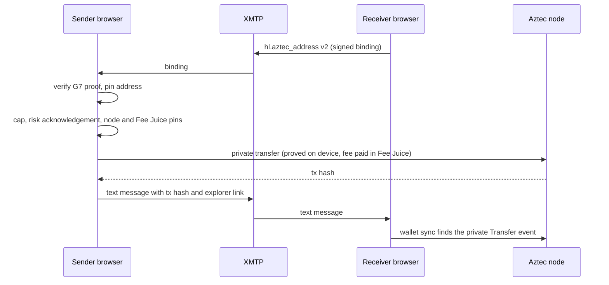
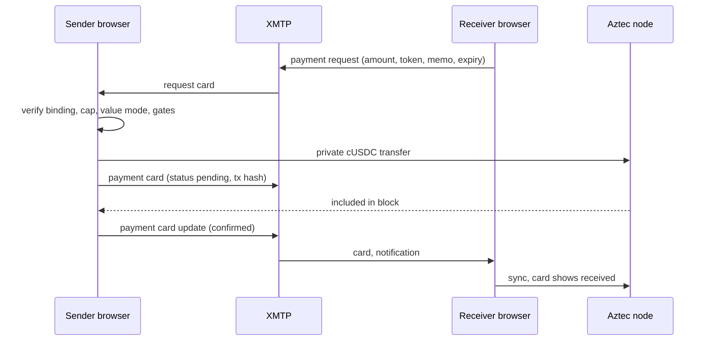
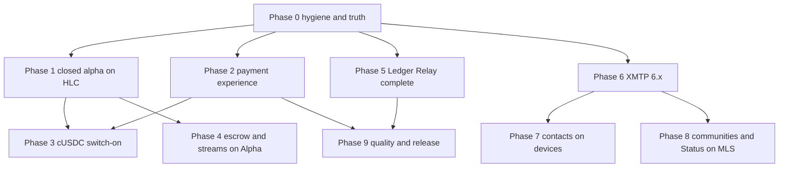

# Ledger Chat: status and phases

Status audit of `humanityledger/Humanity-Ledger` at commit `4e9b37589` (`main`, 22 November 2026), with the phases still needed to make private cUSDC payments in the chat real and every public promise true in the code.

This is a read-only audit. Nothing was deployed, signed or broadcast. No switch, Railway variable, legal text, `lib/docs/pages/protocol.ts` or CI guard was changed. Every claim about the code cites `path:line` or a JSON key. Anything that is not in the repository is marked "not in the repository" and listed as a question for Stefan.

Companion files:

- `docs/plan/backlog.csv`: one row per task in the phases.
- `docs/plan/api-inventory.csv`: all 456 API route handlers, with state and a recommendation.
- `docs/plan/non-english-strings.csv`: every file flagged by the non-English scan (heuristic, see section 9).

## 1. Executive summary

1. **What works today.**
   - Messaging works: XMTP, MLS, `@xmtp/browser-sdk` 5.2.0 (`package.json:177`).
   - 1:1 voice and video calls work. Call set-up goes through Ledger Relay 0.2.0 (`relay/src/server.mjs:31`), with TURN from Cloudflare (`lib/calls/media.ts:171`) and a fallback to the public PeerJS cloud (`lib/calls/media.ts:216`).
   - Private payments in the test token HLC work from a DM on Aztec Alpha. They were proven twice by the operator between his own accounts (`deployments/aztec-mainnet.json` keys `firstPrivatePayment`, `secondPrivatePayment`).
2. **What blocks private cUSDC payments.** It is mostly not code.
   - All nine `CUSDC_GATES` are unmet (`lib/payments/assets.ts:72`): legal, entity, on-chain confirmation, closed alpha results, operator signature, issuer classification, CASP note, sanctions policy, insurance.
   - While they are unmet, the wallet drops cUSDC even if it is configured (`lib/payments/assets.ts:91`).
   - `closedAlpha.enabled` is `false` and `closedAlpha.distributor` is unset (`deployments/aztec-mainnet.json`).
   - cUSDC is recorded in `plannedTokens` with `verifiedOnChain: false`.
3. **The code gaps on the payment path** are smaller, but real:
   - the payment posted in the chat is a plain text sentence with a transaction hash (`lib/payments/direct-private.ts:111`), not a structured payment card with status;
   - there is no payment request and no incoming payment notification;
   - the two-browser sessions for G6 and G7 have never been recorded (`docs/MAINNET_READINESS.md:167`, `:168`);
   - the cUSDC on-chain preflight has not been extended (`docs/payments/CUSDC_INTEGRATION.md:34`).
4. **Hygiene problems found in this audit:**
   - landing footer links that never render their page (section 8);
   - 32 `NEXT_PUBLIC_*` variables read by code but not declared as `ARG` in the `Dockerfile`, including web push and the XMTP environment (section 4, B12);
   - 19 active API routes with no caller in the repository;
   - Spanish text in code, tests and docs (92 files flagged);
   - the claims register still says Ledger Relay is not running for users, which stopped being true today.
5. **Next three actions:**
   - Phase 0 hygiene PRs: links, build arguments, claims register, route retirements, English only.
   - The operator's closed alpha checklist on HLC: HLC redeploy, the G2, G6 and G7 real runs, distributor decision.
   - The structured payment card and payment status in the chat (Phase 2), so cUSDC lands on a finished experience when its gates are met.

## 2. Promise table

The landing, `/brief` and `/record` may only say what the claims register allows (`lib/landing/claims.ts`, enforced by `test/unit/landing/claims-register.test.ts`). The table follows that register, plus the roadmap cards (`lib/landing/chapters.ts:278` to `:282`).

| Promise | Where it is made | Status | Evidence | What is missing |
| --- | --- | --- | --- | --- |
| End-to-end encrypted messages with MLS through XMTP | `lib/landing/claims.ts` row `messages` | Live | `lib/xmtp/client.ts`, `package.json:177` | XMTP 6.x upgrade (B3) |
| Wallet is the account (SIWE), no phone or email | row `identity` | Live | `app/api/siwe`, `lib/security/retiredRoutes.ts` (email sign-in retired) | Duplicate session routes to clean up (B10) |
| Calls peer to peer, encrypted in transit, relay when networks block | row `calls` | Live | `lib/calls/media.ts:171`, `:216`, `:236` | Incoming calls when the app is closed, own TURN (B7) |
| Private payments, amount and recipient hidden | row `payments` (`lib/landing/claims.ts:78`) | Behind switch (closed alpha) | `lib/payments/direct-private.ts:77`, `lib/alpha/gate.ts` | `closedAlpha.enabled` false; G6, G7 runs; payment card (B1) |
| Private USDC in the conversation | row `usdc` (`lib/landing/claims.ts:86`), card `lib/landing/chapters.ts:278` | Behind switch | `lib/payments/assets.ts:72`, `:85` | All nine gates; on-chain preflight; wallet slot (B1) |
| Large files up to 32 GB, encrypted on device | row `files` (`lib/landing/claims.ts:95`) | Behind switch (R2) | `lib/storage/r2.ts:27` | R2 variables not set in Railway (not in the service's variable list); relay blobs not wired (B6) |
| Escrow and payment streams | row `agreements` (`lib/landing/claims.ts:104`), card `lib/landing/chapters.ts:279` | Partial | `lib/aztec/agreements.ts`, `lib/aztec/chat-agreements.ts`, `docs/PENDING_STEFAN.md:8` | Contracts not deployed on Alpha (P-02), no external review (G8) (B2) |
| Status and communities stored on our server | row `statusCommunities` (`lib/landing/claims.ts:112`) | Live | `prisma/schema.prisma:1841`, `app/api/chat/communities` | Accurate as written |
| Communities on MLS | row `communityMls`, card `lib/landing/chapters.ts:281` | Design only | `lib/landing/claims.ts:47`, `prisma/schema.prisma:1632` | Migration (B5) |
| Contacts on your devices | row `contactsOnDevice` (`lib/landing/claims.ts:129`), card `lib/landing/chapters.ts:280` | Design only | `prisma/schema.prisma:365` (server table `ChatContact`) | Whole feature (B4) |
| Ledger Relay: every server we run, runnable by you | row `relay` (`lib/landing/claims.ts:137`), card `lib/landing/chapters.ts:282` | Contradicts code (partly) | `relay/`, `lib/calls/media.ts:216` | Register says "must not say it is running for users": call set-up now runs on it for users. Update the row (section 8) |
| Public record of deployments | row `record`, `/record` | Live | `deployments/aztec-mainnet.json` | None |
| Internal security review, never "audited" | row `security` | Live | `docs/audit/INTERNAL_SECURITY_REVIEW_2026-11-18.md` | `audit` stays `null` |
| Built on XMTP, Aztec and Ethereum (no endorsement) | row `relationships` | Live | `lib/landing/content.ts` | None |
| "Protocol metrics" and "Security" footer links | `components/landing/site/Chrome.tsx:62`, `:82` | Contradicts code | `lib/security/retiredRoutes.ts:388`, `:390`, `middleware.ts:381` | Links redirect away from their pages (section 8) |

Pages under `/docs` (including the 56 diagrams), `/trust`, `/fees` and `/brief` were not traced sentence by sentence in this audit (section 10). Their copy is governed by the same register for the landing only.

## 3. Private cUSDC payments, link by link

| # | Link | Status | Evidence | What is missing |
| --- | --- | --- | --- | --- |
| 1 | Onboarding: SIWE account, Aztec keys derived on device from one EIP-712 signature, account deployed by claiming Fee Juice | Live on testnet; on Alpha proven by the operator only | `lib/aztec/wallet/keys.ts`, `lib/aztec/fee-juice.ts:14`, `deployments/aztec-mainnet.json` key `newUserFlow` | G2 real run by a non-operator user (`docs/MAINNET_READINESS.md:163`); mobile proving time measured on real phones |
| 2 | Getting cUSDC: issued by human.tech through Shield, address copied from Shield's page | Missing | `deployments/aztec-mainnet.json` key `plannedTokens` (`verifiedOnChain: false`), `docs/payments/CUSDC_INTEGRATION.md:19` | Preflight confirmation; Shield links in the wallet; no bridge in our code by design |
| 3 | Fees: each account pays its own fees in Fee Juice; sponsorship removed by product decision | Live (design), not run by real users | `lib/security/retiredRoutes.ts:37`, `docs/PENDING_STEFAN.md` P-03 | Decision on Shield's Bridged FPC for cUSDC users (`docs/payments/CUSDC_INTEGRATION.md`, step 6) |
| 4 | Recipient discovery: peer announces its Aztec address in the DM, pinned on first use, Schnorr proof re-verified before value moves (G7) | Built, not run between two browsers | `lib/aztec/peer-binding.ts:12`, `docs/MAINNET_READINESS.md:168` | Recorded two-browser run; recipient with no Aztec account gets no path today |
| 5 | Sending in a DM: payee is the pinned address, cap per token, risk acknowledgement, node pins re-checked | Built | `lib/payments/direct-private.ts:77`, `components/chat/ZkMoneyModal.tsx:42` | Structured payment message, status lifecycle in the bubble, retry and double-send guard visible to the user |
| 6 | Receiving: wallet rebuilds transfers from private events; chat shows a text sentence with the hash | Partial | `lib/aztec/wallet/history.ts`, `lib/payments/direct-private.ts:111` | Incoming payment card, notification, "received" confirmation in the conversation |
| 7 | Payment requests, links, QR pay, split, refund | Missing | no message type beyond `hl.aztec_address`, `hl.escrow_invite`, `hl.stream_invite` | Request message type and flow (Phase 2) |
| 8 | Balance and history: from the PXE, device-only history for shield and unshield | Live | `lib/aztec/wallet/history.ts` | Export; reconciliation view after reinstall |
| 9 | Recovery: same Ethereum wallet re-derives the same Aztec account; Fee Juice claims recoverable from L1 | Built | `lib/aztec/wallet/keys.ts`, `lib/aztec/wallet/client.ts:817` | User-facing recovery guide; lost-wallet case (funds unrecoverable) stated plainly in the app |
| 10 | Privacy: amount and recipient private; the fee payer account is public; tx hash shared only inside the E2E chat | Live (as stated in the register) | `lib/landing/claims.ts:78`, `lib/payments/direct-private.ts:111`, `lib/aztec/wallet/payment-report.ts` (no amounts or addresses reported) | Per-party table in the docs (server, XMTP, relay, Cloudflare, Railway, sequencer, L1) reviewed against code |
| 11 | Switches: `closedAlpha`, `CUSDC_GATES`, `verifiedOnChain`, value mode (fail-closed exits-only) | Behind switch | `lib/alpha/gate.ts`, `lib/payments/assets.ts:72`, `lib/aztec/value-mode.ts:5` | Stefan's decisions; nothing for agents to flip |
| 12 | Compliance: caps per token, KYC routes, sanctions policy gate, legal notes | Partial | `lib/payments/assets.ts:72` (gates `sanctionsPolicy`, `legalNoteNotCasp`), `docs/PENDING_STEFAN.md` P-08 to P-10 | Counsel and company (not agent work); legal pages not edited here |
| 13 | Tests: unit tests for fees, peer binding, policies, registry | Partial | `test/unit/aztec/` (282 test files in the repo) | End-to-end payment test in two browsers on testnet; skipped fee-router suite (`test/unit/aztec/fee-router.adversarial.test.ts`, 12 `it.skip`) |
| 14 | Launch gate | Not met | below | Everything in the checklist below |

### Current flow (HLC on Alpha, DM)

### Target flow (cUSDC, after the gates)

### Launch gate for the first real cUSDC users

- [ ] All nine `CUSDC_GATES` have `met: true` with evidence, in Stefan's PR (`lib/payments/assets.ts:72`).
- [ ] The read-only preflight confirms the cUSDC instance, class, name, symbol and decimals. `verifiedOnChain` is set in a PR with the run number.
- [ ] A cUSDC cap per payment is signed by Stefan (`NEXT_PUBLIC_AZTEC_AGREEMENT_CAPS`).
- [ ] The closed alpha with HLC has finished within the targets in `docs/alpha/TESTER_MISSIONS.md`.
- [ ] G6 and G7 two-browser runs are recorded (`docs/chat/G6_SESSION_CHECKLIST.md`).
- [ ] An end-to-end test sends, receives and displays a payment card in two browsers on testnet, in CI.
- [ ] Value mode exits-only has been rehearsed in production (`lib/aztec/value-mode.ts`).
- [ ] Incident runbook for payments has been reviewed (`docs/alpha/INCIDENT.md`).
- [ ] Wallet labels cUSDC "Issued by human.tech" with Shield links; landing copy changes only in the same PR (`docs/payments/CUSDC_INTEGRATION.md:34`, step 7).

## 4. Area reports

### B2. Escrow and payment streams

- **Exists:**
  - Noir contracts in `contracts/aztec/escrow` and `contracts/aztec/streams`, with compiled artifacts in their `target/` folders;
  - client open and accept flows (`lib/aztec/agreements.ts`, `lib/aztec/chat-agreements.ts`) and stream terms with bounded start slack (`lib/aztec/stream-terms.ts`);
  - chat cards and a composer (`components/chat/AgreementComposer.tsx`, `components/chat/AgreementCard.tsx`);
  - a policy gate (`lib/protocol/agreement-gate.ts`, `lib/aztec/agreement-policy.ts`).
- **Missing:**
  - deployment on Alpha (P-02, Stefan, `docs/CONTRACT_DEPLOY_CHECKLIST.md`);
  - an external review (G8, `docs/MAINNET_READINESS.md:169`);
  - closed alpha classes in `closedAlpha.classes`;
  - dispute and partial release (not in the design documents read).
- **Risk:** value locked in unaudited contracts. The landing already says "refused on Aztec Alpha until an external audit" (`lib/landing/claims.ts:104`).

### B3. Messaging core

- **Exists:**
  - XMTP browser SDK 5.2.0. The env defaults to `production` (`lib/xmtp/client.ts:44`), but `NEXT_PUBLIC_XMTP_ENV` is not a Docker `ARG`, so the Railway value never reaches the build. The default happens to match.
  - Delete and clear chat with cut-off and synced deletion (`lib/chat/cleared-chats.ts`), contact requests (`/api/chat/contacts/request`), usernames (`/api/chat/username`), and profile photos (`/api/user/profiles`).
- **Missing:** the XMTP 6.x migration plan (breaking changes, local database migration, installation limits, payer wallet decision).
- **Risk:** the 5.x end of support date is not in the repository (question for Stefan or XMTP).

### B4. Contacts on your devices

- **Today:** contacts live on our server (`prisma/schema.prisma:365` `ChatContact`, `:389` `PendingChatMessage`, `/api/chat/contacts`).
- **Target:** an encrypted list on the device, synced between the user's devices through XMTP (for example a private group or the device sync channel), and server copies deleted after migration.
- **Missing:** design document, migration, deletion job, and tests.

### B5. Groups, communities and Status

- **Exists:**
  - communities, apps, posts, proposals, gates and members (`/api/chat/communities*`, 13 active routes);
  - Stories and Status media (`prisma/schema.prisma:1841`, `/api/chat/stories*`);
  - a per-community `communityMls` column defaulting to false (`prisma/schema.prisma:1632`), already respected by the posts and members routes.
- **Missing:**
  - the MLS migration itself (`docs/communities/MLS_MIGRATION.md`, written in Spanish);
  - Status on MLS;
  - a moderation model for E2E communities.

### B6. Media and files

- Large files use R2 and are off while the R2 variables are unset (`lib/landing/claims.ts:95`, `lib/storage/r2.ts:27`; R2 variables are not in the Railway variable list read on 22 November 2026).
- The relay offers encrypted blob storage (`lib/relay/client.ts:50`), but no UI calls it: only `iceFromRelays` is imported (`lib/calls/media.ts:22`). The relay has no volume, so blobs are lost on restart.
- **Decision for Stefan:** R2 or relay blobs as the file store (section 7).

### B7. Calls

- **Live:** 1:1 calls with the state machine (`lib/calls/machine.ts`), TURN from Cloudflare, and signalling through the relay with PeerJS fallback.
- **Retired at the edge:** group call rooms `/api/call/*` (`docs/plan/api-inventory.csv`), although the `CallRoom` and `CallRoomToken` models remain.
- **Missing:**
  - incoming calls when the app is closed or the phone is locked (needs push, B9);
  - own TURN (`relay/coturn`);
  - a two-browser end-to-end call test in CI;
  - screen share and group calls (not in the current UI; to be decided).

### B8. Ledger Relay to full production

- **Running:** 0.2.0 with signalling and blobs. TURN and push are off. `access: open`, no volume, one replica (Railway service config, 22 November 2026).
- **Missing:**
  - TURN (`RELAY_TURN_*` plus coturn);
  - VAPID push;
  - a volume at `/data`;
  - `RELAY_ACCESS_TOKENS` or rate limits reviewed for open access;
  - monitoring of `/health`;
  - the user-chosen relays UI (`lib/relay/relays.ts`);
  - protocol versioning beyond `ledger-relay/0`;
  - retiring `peerjs-server`;
  - the public repository `humanityledger/ledger-relay`, an old full copy of the web app.

### B9. Notifications

- **Not live:** web push is not enabled.
  - `NEXT_PUBLIC_VAPID_PUBLIC_KEY` is read by the client (`lib/push/usePushNotifications.ts:56`) and server (`app/api/push/send/route.ts:34`), but it is neither a Docker `ARG` nor a Railway variable.
  - `VAPID_PRIVATE_KEY` is not in the Railway variable list either.
- **Missing:** keys, ARG, payload privacy review (opaque wake-ups only), incoming call and incoming payment notifications, and per-chat mute.

### B10. Accounts, security and privacy

- **Exists:**
  - `start.sh` generates a random per-boot value when secrets are missing, with a warning;
  - Railway does define `ENCRYPTION_KEY`, so the build-time warning is a build artefact only;
  - the middleware covers every API path (`middleware.ts:581`) and answers retired routes with 410 (`middleware.ts:393`);
  - Studio is locked (`middleware.ts:373`).
- **Missing:**
  - duplicate session surfaces: `/api/siwe/*` and `/api/auth/siwe/*` both active, and `/api/siwe/session` and `/api/auth/siwe/session` have no caller;
  - P-04 provider keys moved from `NEXT_PUBLIC_*` names (`docs/PENDING_STEFAN.md:10`).
- **Risk:** `TREASURY_WALLET_ADDRESS` defaults to the zero address (`start.sh:25`) for the legacy golden ticket route, which is still active (B11).

### B11. Legacy and dead code

- **Routes.** Of 456 route handlers:
  - 279 are retired at the edge;
  - 24 already answer 410 inside the handler;
  - 153 are active, of which 19 have no caller in the repository (four of those are external webhooks or internal jobs).
  - Full list with recommendations: `docs/plan/api-inventory.csv`.
- **Active legacy surfaces to retire or justify:**
  - `golden-ticket/claim` and `stats` (Optimism mint fee, treasury variable);
  - Stripe plans (`/api/payments/*`, `/api/subscription/status`);
  - market, mempool, news, ledger stream, scanner, bots, bridge, `/api/v1/*`;
  - studio (locked at the edge, handlers still present).
- **Pages.**
  - `app/protocol`, `app/security` and `app/status` exist, but the middleware redirects their paths (`lib/security/retiredRoutes.ts:388`, `:390`), so they never render.
  - Old landing trees `components/landing/immersive` (104 KB) and `components/landing/mobile` (64 KB) are only referenced from comments and from other old landing files.
  - `app/page.tsx` imports only `SiteLanding`.

### B12. Platform and operations

- **Build arguments.** 32 `NEXT_PUBLIC_*` names are read in code but not declared in the `Dockerfile`. Those that matter for Ledger Chat:
  - `NEXT_PUBLIC_XMTP_ENV`;
  - `NEXT_PUBLIC_VAPID_PUBLIC_KEY`;
  - `NEXT_PUBLIC_ENCLAVE_PIN_LOCK`;
  - `NEXT_PUBLIC_AZTEC_NODE_RELAY`;
  - `NEXT_PUBLIC_DOMAIN` (SIWE nonce);
  - `NEXT_PUBLIC_RP_ID`;
  - `NEXT_PUBLIC_LEDGER_RELAY_LIST_KEY`;
  - `NEXT_PUBLIC_R2_PUBLIC_URL`;
  - `NEXT_PUBLIC_AZTEC_PXE_URL`;
  - `NEXT_PUBLIC_TURN_*`.

  The rest belong to legacy code. The full list comes from this audit's scan and should be pinned by extending `test/unit/relay/dockerfile-args.test.ts`.
- **Minification** is disabled on purpose (`next.config.js:341`), with an explanation in the surrounding comment. It is a size and performance cost to revisit.
- **Boot and healthcheck.** The app runs migrations at boot (`start.sh:32`), so the first healthchecks fail while it boots (deploy log of 22 November 2026). Consider Railway's pre-deploy command.
- **Dependencies.**
  - GitHub reports 4 Dependabot alerts on `main` (push output, 22 November 2026).
  - P-13 `pm2` to `basic-ftp` is still open (`docs/PENDING_STEFAN.md:19`).
  - `@aztec/bb.js` is pinned at 5.3.0 while the `@aztec-labs/*` packages are 6.0.0 (`package.json:80` to `:86`); confirm that this pairing is intended.

### B13. Product surface and copy

- **Footer links.** "Protocol metrics" and "Security" redirect away from the pages they name (section 8).
- **Relay claim.** The relay row in the claims register needs updating (section 8).
- **Language.** Non-English text is present in 92 files, including UI strings in `lib/community-apps/templates.ts`, `components/zk/ZkSequencerDashboard.tsx` and `components/chat/community-apps/CommunityApps.tsx`, a Spanish UI locale in Studio (`lib/studio/i18n.ts:5`), test names (`test/unit/aztec/fee-router.adversarial.test.ts`, `test/gate/j-skeleton.test.ts`) and documents (section 9).
- **Image licences.** The licence of the mockup photos (`scripts/landing/mockups-src/`) is not recorded in the repository.

### B14. Testing and release

- **Suites.** 282 test files; vitest is the runner (`package.json:29` to `:34`). Skipped:
  - 12 fee-router tests for a design that is not being built;
  - the `J-00x` gate skeleton (`test/gate/j-skeleton.test.ts:28`).
- **Workflows.** 25 in `.github/workflows/`, including the Aztec mainnet preflight, WebKit runs and the security review.
- **Missing:**
  - two-browser end-to-end tests for chat, calls and payments;
  - a staging environment (not in the Railway project, which has only `production`);
  - a written release and rollback checklist for the web app.

## 5. Phases

Sizes: S (a day or less of agent work), M (a few PRs), L (a project). No dates. Agents open PRs on `claude/` branches; Stefan merges.

### Phase 0. Hygiene and truth

**Goal:** the product says only what is true, and the build carries every variable the code reads.

- **Tasks:**
  - Fix the footer links in `components/landing/site/Chrome.tsx:62`, `:82`, or restore the pages (decision D-1).
  - Update the `relay` row of `lib/landing/claims.ts:137`, citing the merged code (decision D-2).
  - Declare the missing Ledger Chat `NEXT_PUBLIC_*` names as `ARG`s and extend `test/unit/relay/dockerfile-args.test.ts` to every client variable used by Ledger Chat code.
  - Retire the 19 unreferenced active routes and the legacy active surfaces agreed in D-7 (`lib/security/retiredRoutes.ts`, then delete handlers).
  - Delete the old landing trees after an import-graph check.
  - Translate every non-English string in code, tests and docs (D-11 for the Studio locale).
  - Resolve Dependabot alerts and P-13.
  - Archive or make private `humanityledger/ledger-relay` (D-10, Stefan).
- **Acceptance:**
  - `npx vitest run` and `npx tsc --noEmit` pass;
  - the claims-register test passes;
  - a re-run of the non-English scan reports no code, UI or test file;
  - `/protocol` and `/security` links land on a page that exists;
  - `docs/plan/api-inventory.csv` regenerated shows no active unreferenced route except agreed webhooks.
- **Risks:** retiring a route a phone still calls. Mitigation: the edge 410 first, the handler deletion one release later.
- **Unblocked by:** D-1, D-2, D-7, D-10, D-11. **Size:** M. **Unblocks:** all later phases.

### Phase 1. Closed alpha on HLC (operator track)

**Goal:** real testers send HLC privately in DMs under the closed alpha rules.

- **Tasks (Stefan and counsel):**
  - HLC redeploy with a neutral on-chain name (`docs/alpha/HLC_REDEPLOY_RUNBOOK.md`);
  - G2 real run by a fresh user;
  - G6 and G7 two-browser sessions (`docs/chat/G6_SESSION_CHECKLIST.md`);
  - set `closedAlpha.distributor` and `closedAlpha.enabled`;
  - create the `alpha-purge` service and `ALPHA_FEE_JUICE_BUDGET`;
  - sign alert thresholds (`docs/plan/REPORT_2026-11-19.md`, "Waiting on Stefan").
- **Tasks (agents):**
  - the preflight PR retiring the old HLC instance after the redeploy;
  - a tester-facing guide in `/docs`.
- **Acceptance:**
  - preflight green;
  - recorded G6 and G7 sessions linked in `docs/MAINNET_READINESS.md`;
  - first wave invited.
- **Risks:** testers lose test funds through UX errors, with low value at stake. **Unblocked by:** D-3 (distributor), counsel. **Size:** M. **Unblocks:** Phase 3 gate `alpha`.

### Phase 2. Payment experience in the chat

**Goal:** a payment in a conversation looks and behaves like a payment, not a text message.

- **Tasks:**
  - Add a versioned `hl.payment` message type (token, tx hash, status, optional memo, never the amount in clear outside the E2E message) in `lib/payments/direct-private.ts` and render it in `components/chat/MessageBubble.tsx`.
  - Track the lifecycle: attempted, proving, sent, mined, unconfirmed, failed, mapped to `lib/aztec/wallet/payment-report.ts` stages.
  - Show a receiver card when the wallet sync finds the transfer.
  - Add an `hl.payment_request` message type with expiry, and a pay button that opens `ZkMoneyModal` prefilled.
  - Guard against double sends while a payment is in flight.
  - Add an in-app recovery guide.
  - Build a two-browser Playwright test on testnet for request, pay, confirm.
- **Acceptance:**
  - unit tests for message parsing and versioning;
  - Playwright test green in CI;
  - old text-only payments still render.
- **Risks:**
  - card spoofing by the peer. Mitigation: the card is verified against the receiver's own wallet history before it shows "received".
- **Unblocked by:** none. **Size:** L. **Unblocks:** Phase 3 UX.

### Phase 3. cUSDC switch-on

**Goal:** cUSDC appears in the wallet and the chat only when every gate is met, and works end to end.

- **Tasks:**
  - Extend `test/live/aztec-mainnet-preflight.live.test.ts` to read the cUSDC instance.
  - Record the token in `tokens` with its class.
  - Fill the `CUSDC` wallet slot.
  - Label cUSDC "Issued by human.tech" and add Shield links.
  - Set the cap per payment.
  - Decide on Bridged FPC (D-5).
  - Switch the landing copy in the same PR that Stefan merges with the gates (`docs/payments/CUSDC_INTEGRATION.md:34`, steps 1 to 8).
- **Acceptance:** the launch gate checklist in section 3, every box ticked with evidence.
- **Risks:** regulatory exposure (gates `legal`, `legalNoteNotCasp`, `sanctionsPolicy`, `insurance`), and wrong token address (gate `onchain`).
- **Unblocked by:** D-4, D-5, counsel, entity, insurance, human.tech's written answer. **Size:** M (code), L (non-code).

### Phase 4. Escrow and streams on Alpha

**Goal:** agreements open on Alpha for closed alpha members.

- **Tasks:**
  - deploy PrivateEscrow and PaymentStream (P-02, Stefan);
  - external review (G8);
  - add the classes to `closedAlpha.classes`;
  - record the two-account agreement session;
  - design disputes and partial release, if wanted.
- **Acceptance:**
  - preflight checks the instances;
  - `.github/workflows/aztec-escrow-e2e.yml` green against testnet;
  - the review report is recorded in `deployments/aztec-mainnet.json` `audit`.
- **Unblocked by:** Stefan, auditor. **Size:** L.

### Phase 5. Ledger Relay complete

**Goal:** the relay carries TURN, push and files reliably, and anyone can run one.

- **Tasks:**
  - coturn with `RELAY_TURN_*`;
  - VAPID push through the relay, or through the app server (D-6);
  - a volume at `/data`;
  - an access policy;
  - uptime monitoring;
  - wire `uploadCiphertext` for large files if D-4 picks the relay;
  - the user relays UI;
  - retire `peerjs-server`;
  - a protocol version bump policy.
- **Acceptance:**
  - relay tests pass;
  - a call through TURN-only networks succeeds;
  - push wakes a closed PWA;
  - blobs survive a restart.
- **Unblocked by:** D-4, D-6. **Size:** L. **Unblocks:** incoming calls (Phase 9) and file sharing.

### Phase 6. XMTP 6.x

**Goal:** the messaging SDK is on a supported major version.

- **Tasks:**
  - migration plan and SDK upgrade;
  - local database migration;
  - payer wallet decision (D-8);
  - regression tests for delete, sync and attachments.
- **Acceptance:** chat regression suite and two-browser chat test green.
- **Size:** L. **Unblocks:** Phases 7 and 8.

### Phase 7. Contacts on your devices

**Goal:** our server no longer holds contact lists.

- **Tasks:**
  - design document;
  - encrypted device list synced over XMTP;
  - migration from `ChatContact`;
  - server-side deletion;
  - copy change in the register.
- **Acceptance:** no contact rows for migrated users, and the register row moves only then.
- **Size:** L.

### Phase 8. Communities and Status on MLS

**Goal:** our server no longer holds community posts or Status.

- **Tasks:**
  - English rewrite of `docs/communities/MLS_MIGRATION.md`;
  - MLS groups per community;
  - moderation model;
  - migration;
  - `communityMls` set per community by Stefan.
- **Acceptance:** posts of migrated communities never reach `CommunityPost`.
- **Size:** L.

### Phase 9. Quality and release

**Goal:** every change ships through the same safe path.

- **Tasks:**
  - a staging environment in Railway (D-9);
  - release and rollback checklist;
  - two-browser end-to-end tests for chat, calls and payments in CI;
  - incoming calls through push;
  - observability dashboards from the delivery and payment reports;
  - revisit minification and boot time.
- **Size:** M.

## 6. Dependency graph

## 7. Decisions for Stefan

| Id | Decision | Options and consequences |
| --- | --- | --- |
| D-1 | `/protocol`, `/security`, `/status` pages | Restore them (remove the redirects, review their copy) or point the footer at `/docs/security-model` and remove the pages |
| D-2 | Relay claim wording | Keep "In design" and drop the "must not say it is running" line; or split the row into call set-up (Live) and the full relay (In design) |
| D-3 | `closedAlpha.distributor` | Company or person per counsel; until set, no invitation can be created |
| D-4 | File storage | R2 (managed, needs four Railway variables) or relay blobs (self-hostable, needs a volume and wiring) |
| D-5 | Fees for cUSDC users | Users bridge AZTEC (today) or Shield's Bridged FPC (fewer steps, adds a third party to the fee path) |
| D-6 | Push | App server VAPID (simpler) or relay push (self-hostable, opaque wake-ups) |
| D-7 | Legacy surfaces | Retire golden ticket, Stripe plans, market, mempool, news, bots, bridge and v1 routes, or keep any with a stated owner |
| D-8 | XMTP payer wallet for 6.x | Not in the repository |
| D-9 | Staging environment | A second Railway environment or none |
| D-10 | Public `humanityledger/ledger-relay` repository | Archive, make private, or delete |
| D-11 | Studio Spanish locale | Remove it (English only) or keep it as a user-facing locale |
| D-12 | Existing open decisions | `docs/plan/REPORT_2026-11-19.md` D-1 and D-6, the `/trust` timings, and R2 (questions Q1 to Q10 stay open) |

## 8. Public copy to fix

| Location | Current text | Proposed replacement |
| --- | --- | --- |
| `components/landing/site/Chrome.tsx:62` | Link "Protocol metrics" to `/protocol` (redirected to `/`) | Remove the link, or keep it after D-1 restores `/protocol` |
| `components/landing/site/Chrome.tsx:82` | Link "Security" to `/security` (redirected) | "Security" to `/docs/security-model` |
| `lib/landing/claims.ts:137` (`mustNot`) | "That it is running for users, that it carries payments, or any number of transfers." | "That it carries payments, that every server already runs on it, or any number of transfers." |
| `lib/landing/claims.ts:137` (`may`) | "Lets anyone run the servers Ledger Chat needs: calls, encrypted files and notifications. A reference implementation is developed in the open." | "Call set-up already runs on our own Ledger Relay. The same software will carry encrypted files and notifications, and anyone can run it." |
| `docs/communities/MLS_MIGRATION.md:1` | Spanish title and body | English translation, same content |

Any label change in the register needs a PR that cites the merged code (`lib/landing/claims.ts:1` to `:15`).

## 9. Non-English strings

A heuristic scan of the repository flagged 92 files and 1,979 lines, excluding `node_modules`, `vendor`, `public`, `audits`, `docs/archive` and `docs/legal`. The full list, with line numbers, is in `docs/plan/non-english-strings.csv`. Contract and circuit `target/*.json` artifacts are likely false positives.

| Path | Lines flagged | Kind |
| --- | --- | --- |
| `lib/studio/i18n.ts` | 38 | Studio Spanish locale (D-11) |
| `lib/studio/i18n-code.ts` | 30 | Studio Spanish locale (D-11) |
| `test/gate/j-skeleton.test.ts` | 39 | Test names and comments |
| `test/unit/contracts/HumanityTimeLockVault.adversarial.test.ts` | 28 | Test names and comments |
| `test/unit/aztec/fee-router.adversarial.test.ts` | 27 | Test names (skipped suite) |
| `lib/security/studio-identity-adapter.ts` | 16 | Comments |
| `lib/community-apps/templates.ts` | 12 | UI template strings |
| `ignition/modules/LedgerDeadmanSwitch.ts` | 9 | Comments |
| `contracts/mocks/ReentrancyAttacker.sol` | 8 | Comments |
| `app/api/security/scan/route.ts` | 7 | Comments or messages |
| `app/api/news/share/route.ts` | 6 | Strings (legacy route) |
| `lib/blockchain/rpc-relayer.ts` | 6 | Comments |
| `components/zk/ZkSequencerDashboard.tsx` | 3 | UI strings |
| `components/chat/community-apps/CommunityApps.tsx` | 2 | UI strings |
| `prisma/schema.prisma` | 2 | Comments |
| `docs/antigravity/BACKLOG.md`, `docs/zk/MASTER_PROMPT.md`, the 8 files in `docs/plan/prompts/` and 37 other documents (47 in total) | 1,694 | Documents |

The prompt files in `docs/plan/prompts/` are the operator's original instructions. Translating them is D-11's call, because they are quoted as the source of authority.

## 10. Not verified, and what was run

**Not verified:**

- **Tests.** No test suite was run. vitest could not start in this environment (the rollup native module for Linux is missing from the Windows `node_modules`). The relay suite (`relay/test/relay.test.mjs`, 10 tests) was last run green on 22 November 2026 with Node 22.
- **Railway values.** Variable values were not read, only names. Whether `NEXT_PUBLIC_XMTP_ENV` in Railway equals the code default is unknown.
- **Pages not traced.** `/docs` pages, `/trust`, `/fees` and `/brief` were not traced sentence by sentence against the code.
- **Routes.** "Referenced" means the route's static prefix appears in `components`, `lib`, `hooks`, `context`, `app`, `scripts`, `public/sw.js` or `.github`. Dynamic URL building may hide a caller. Check each retirement by hand.
- **Language scan.** The non-English scan is a word-list heuristic, with false positives and negatives.
- **Not in the repository:** Dependabot alert details, the XMTP 5.x end of support date, and the licence of the landing photos.

**Commands run (read only):**

- `git worktree add -b claude/status-and-phases-2026-11-22 … origin/main`
- `find app -name page.tsx`, `find app/api -name route.ts` (31 pages, 456 route handlers)
- A route classifier against `lib/security/retiredRoutes.ts` and the repository's `/api/` references (output: `docs/plan/api-inventory.csv`)
- `grep` for `process.env.NEXT_PUBLIC_*` against the `Dockerfile`'s `ARG` and `ENV` lines (61 names read, 32 undeclared)
- `grep` for flags, `TODO`, `FIXME`, `HACK` (12 in app code) and skipped tests
- A Prisma model count (107 models, 31 migrations)
- A non-English scan (output: `docs/plan/non-english-strings.csv`)
- Railway reads through the Railway connector: service list, service configuration, variable names, deployment list, relay HTTP logs
